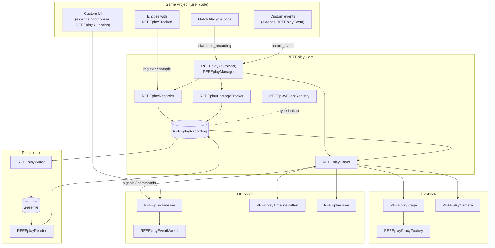
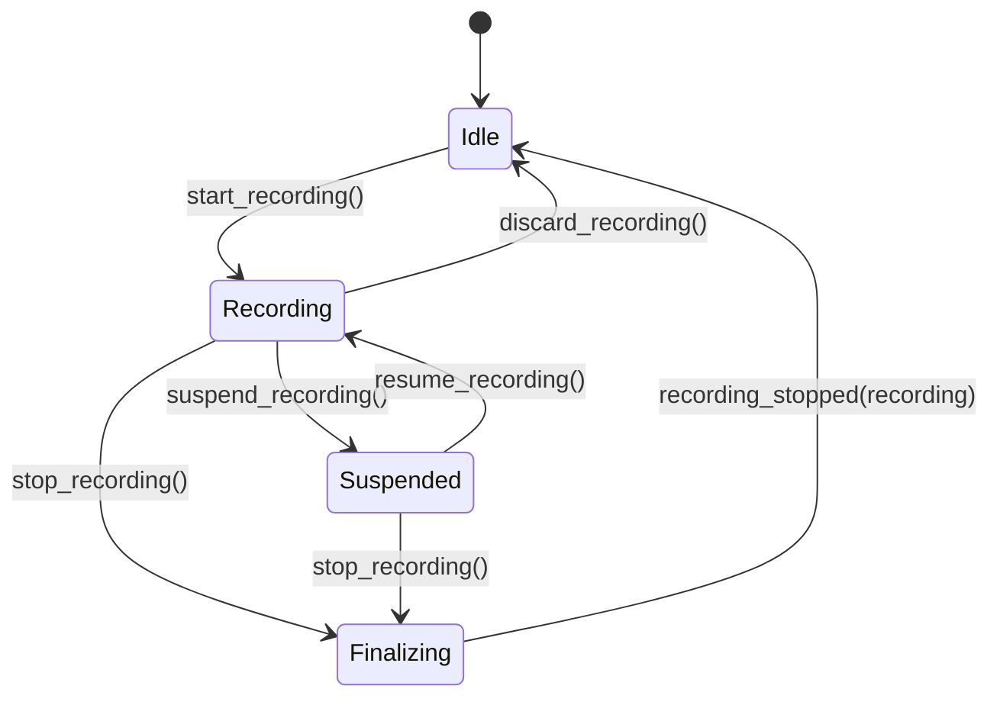
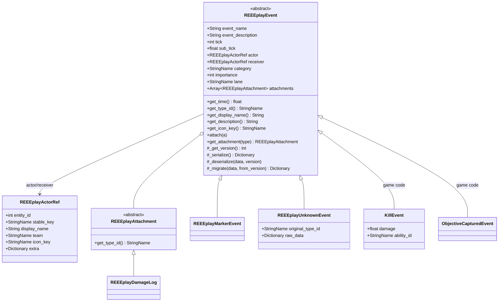
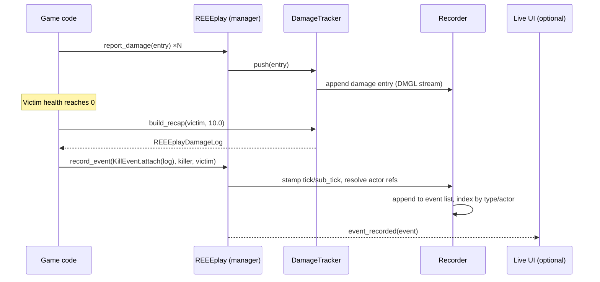
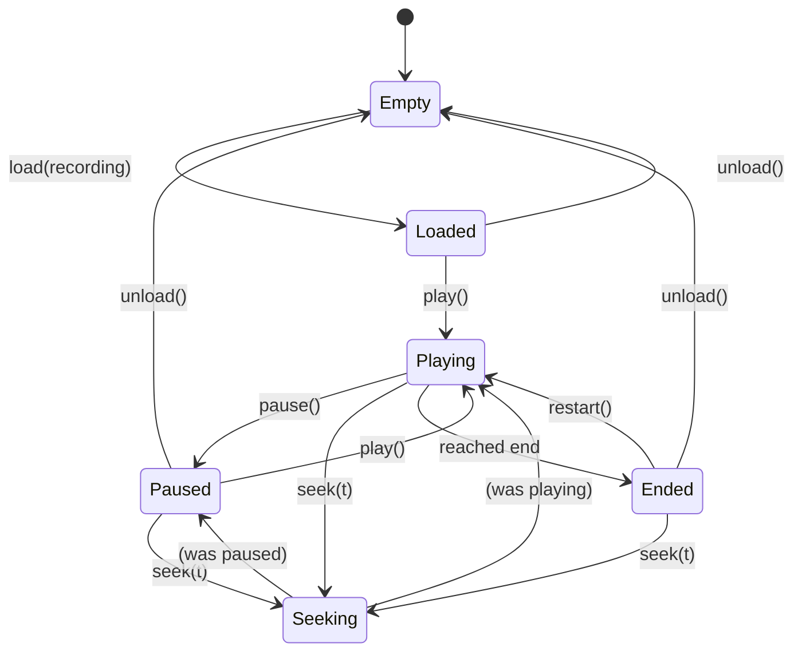
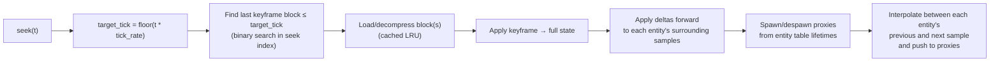
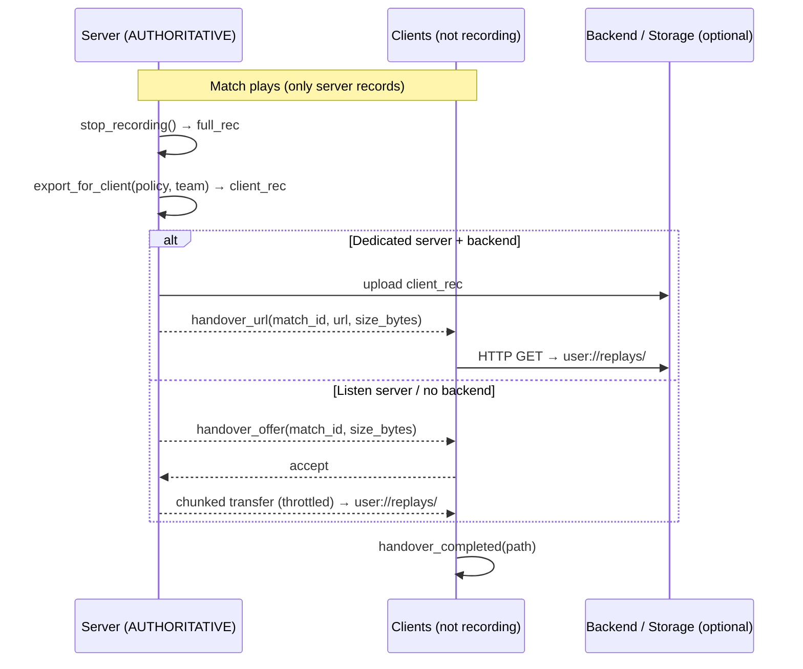
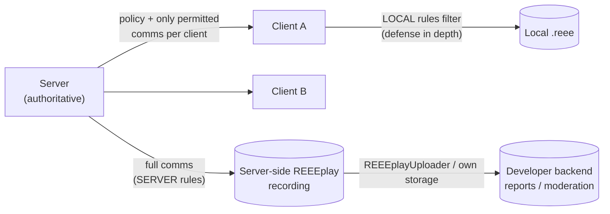
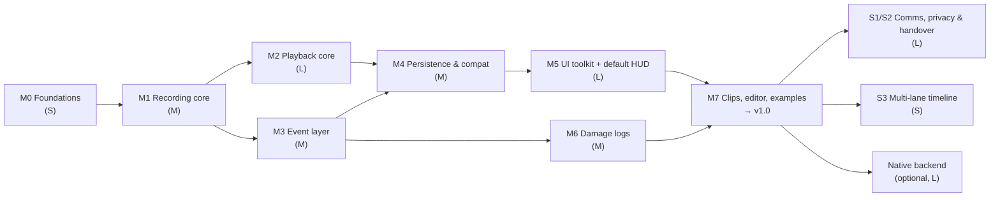

# REEEplay — Implementation Document

> A replay recording, playback and event-timeline addon for Godot 4.8+.

| Field | Value |
|---|---|
| **Addon name** | REEEplay |
| **Origin** | Tongue-in-cheek mix of *"REEE"* (the internet rage scream) and *"replay"*. It's the button you hit after something rage-inducing (or hilarious) happens. |
| **Target engine** | Godot 4.8+ |
| **Language** | GDScript (statically typed), with optional native acceleration later (see [§16](#16-performance-strategy)) |
| **Target games** | Multiplayer, friendslop, competitive |
| **Tags** | Utility, Analysis, Fun |
| **Document status** | Draft v1. Source: `Vault/REEEplay - A Godot Addon.md` |

---

## Table of Contents

1. [Vision & Scope](#1-vision--scope)
2. [Design Principles](#2-design-principles)
3. [Glossary](#3-glossary)
4. [Architecture Overview](#4-architecture-overview)
5. [Addon Layout](#5-addon-layout)
6. [Time Model & Recording Rate](#6-time-model--recording-rate)
7. [Recording Lifecycle](#7-recording-lifecycle)
8. [Entity Tracking](#8-entity-tracking)
9. [The Event Layer](#9-the-event-layer)
10. [Damage Logs](#10-damage-logs)
11. [Playback](#11-playback)
12. [File Format & Persistence](#12-file-format--persistence)
13. [Backward & Forward Compatibility](#13-backward--forward-compatibility)
14. [UI Toolkit (Bring-Your-Own-UI)](#14-ui-toolkit-bring-your-own-ui)
15. [Multiplayer Considerations](#15-multiplayer-considerations)
16. [Performance Strategy](#16-performance-strategy)
17. [Configuration (Project Settings)](#17-configuration-project-settings)
18. [Editor Integration](#18-editor-integration)
19. [Public API Reference](#19-public-api-reference)
20. [Usage Walkthroughs](#20-usage-walkthroughs)
21. [Stretch Goal: Communication Capture & Privacy](#21-stretch-goal-communication-capture--privacy)
22. [Security](#22-security)
23. [Testing Strategy](#23-testing-strategy)
24. [Roadmap & Milestones (MoSCoW)](#24-roadmap--milestones-moscow)
25. [Risks & Mitigations](#25-risks--mitigations)
26. [Open Questions](#26-open-questions)
27. [Optional Integration: `yeet-cpp`](#27-optional-integration-yeet-cpp)
28. [Appendix A — Reference: League of Legends Replay Timeline](#appendix-a--reference-league-of-legends-replay-timeline)
29. [Appendix B — Codec Table](#appendix-b--codec-table)

---

## 1. Vision & Scope

REEEplay lets a Godot game **record the state of its world plus the important things that happen in it**, and **play that back inside the game**. Players can rewatch funny moments, big plays and deaths. Developers get a structured log of what happened in a match.

### 1.1 Goals (in scope for v1.0)

| # | Goal | Summary |
|---|---|---|
| G1 | **Bring-your-own-UI** | Ship a working default HUD for testing and baseline looks. The real product is a set of styleable, composable UI nodes (`REEEplayTimeline`, `REEEplayTime`, `REEEplayTimelineButton`, `REEEplayEventMarker`, …) that games can theme, extend or replace completely. |
| G2 | **Efficient world recording** | Record tracked entities and how they change, as efficiently as GDScript allows. The format stays readable as the addon and the game evolve. |
| G3 | **Generic event layer** | A `REEEplayEvent` base class (*name, description, time, actor, receiver*, …) that games extend. The addon has no game-specific knowledge. It is extended from outside only. |
| G4 | **Damage logs** | Build damage logs during recording, for death recaps and damage-dealt summaries. They can be attached to events, e.g. a *Kill* event that carries a `REEEplayDamageLog`. |
| G5 | **Simple lifecycle** | Start and stop recordings with one call each, e.g. a new `REEEplayRecording` per match. |

### 1.2 Stretch goals

| # | Stretch goal | Section |
|---|---|---|
| S1 | Capture multiplayer communication (text chat, optionally voice) and optionally upload to a developer-provided server, for reporting and moderation. | [§21](#21-stretch-goal-communication-capture--privacy) |
| S2 | Privacy policies set by the server (e.g. you can't see enemy team chat or hear enemy voice in your local replay). Local-replay rules differ from server-side rules. | [§21](#21-stretch-goal-communication-capture--privacy) |
| S3 | Multi-lane / per-team timelines, like the two-lane LoL timeline. "Fun to have", on the roadmap. | [§14.6](#146-multi-lane-timelines-stretch) |

### 1.3 Non-goals

- **Deterministic input replay / lockstep re-simulation.** Godot physics isn't deterministic across machines or runs, so REEEplay records **state snapshots**, not inputs. See [§2](#2-design-principles).
- **Video capture/encoding.** REEEplay replays inside the engine. Exporting to MP4 is out of scope. Godot's Movie Maker mode can be pointed at a replay if needed.
- **Game-specific concepts** (teams, abilities, gold, objectives) in the core. These are expressed through user-defined event subclasses and metadata.
- **Anti-cheat.** Server-side recordings help moderation ([§21](#21-stretch-goal-communication-capture--privacy)), but REEEplay doesn't detect cheats.

### 1.4 Primary Use Cases

#### UC1 — Friendslop / Party Chaos Clips
- **Actors:** Players in a P2P or listen-server co-op lobby.
- **Configuration:** `FUN_GAME` preset (`RING_BUFFER` 90 s, 20 Hz base, `REEEplayHighlightDetector`, `REEEplayRatePolicy` event boost).
- **Preconditions:** Tracked characters, props, and projectiles have `REEEplayTracked` nodes; `REEEplay` is running in ring-buffer mode.
- **Flow:**
  1. Players play normally; `REEEplay` keeps only the rolling 90 s window in memory, evicting old blocks on keyframe boundaries.
  2. When a chaotic chain of events occurs (or a player presses the `"clip_that"` keybind), `REEEplayHighlightDetector` or `REEEplay.save_clip(15.0, 3.0)` captures the window and boosts affected entities to 60 Hz for 2 s.
  3. The player opens the clip in `REEEplayTimeline` with `show_trim_handles = true`, drags the in/out handles to the best 10 seconds, and saves via `recording.slice(trim_start, trim_end)`.
- **Edge cases:** Host disconnects mid-session (clients still keep their own `LOCAL` ring buffer); pooled projectiles call `respawn()` so they don't streak across the arena.

#### UC2 — Competitive Match Replay & Death Recap
- **Actors:** Competitive players, match server.
- **Configuration:** `COMPETITIVE` preset (`FULL_WITH_RING`, 30 Hz base, 3 s keyframes, `REEEplayDamageTracker` + combat boost).
- **Preconditions:** Damage sources call `REEEplay.report_damage(entry)`; `KillEvent` attaches `REEEplay.damage.build_recap(victim, 10.0)`.
- **Flow:**
  1. During gameplay, two players fight. `REEEplayRatePolicy` detects `combat_started` and boosts both combatants to 60 Hz.
  2. Victim dies. The death screen immediately opens a `SubViewport` with `REEEplayStage` + `REEEplayPlayer` playing the last 6 s from the in-memory ring buffer as a kill cam, alongside `REEEplayDamageRecap` showing top damage sources and the lethal blow.
  3. After the match, the full `.reee` recording is finalized and opened in the replay viewer with `REEEplayScoreboard` (live K/D/A while scrubbing), `REEEplayTimeline` event markers, and `REEEplayEventCard` hover stacks.
- **Edge cases:** Seeking across combat-boost rate changes interpolates smoothly between each entity's `s0`/`s1` sample schedule; `ON_CHANGE` keeps idle map entities at ~0 bytes/s.

#### UC3 — Server-Authoritative Handover & Moderation
- **Actors:** Dedicated server, clients, moderators.
- **Configuration:** `ESPORTS` or `COMPETITIVE` on the server (`AUTHORITATIVE` perspective, `REEEplayPrivacyPolicy` with separate `LOCAL` and `SERVER` rules); clients do not record locally.
- **Preconditions:** `reeeplay/net/enabled = true`; privacy policy distributed at match start.
- **Flow:**
  1. Only the server records the match, capturing full authoritative world state, all team chats, and optional voice (`COMM` chunks), signed with `SIGN` (HMAC-SHA256).
  2. On match end, the server calls `recording.export_for_client(policy, viewer_team)` to strip `SERVER`-only `COMM` streams and enemy team chat/voice, leaving the server's original intact.
  3. The server uploads the scrubbed `.reee` to CDN/storage (`REEEplay.net.send_replay_url()`) or streams it in throttled chunks (`REEEplay.net.send_recording()`). Clients accept `handover_offer_received` and save to `user://replays/`.
  4. If a player files a report, moderators pull the signed `AUTHORITATIVE` slice from the server.
- **Edge cases:** Untrusted client uploads are rejected; `allow_local_recording = false` prevents fog-of-war leaks mid-match.

#### UC4 — Singleplayer / Sandbox Playthroughs
- **Actors:** Solo player, speedrunner, QA tester.
- **Configuration:** `SINGLEPLAYER` preset (30 Hz, `FULL`, `5 s` keyframes, Distance LOD on) via a `REEEplaySession` node.
- **Preconditions:** Level scene contains a `REEEplaySession` node with `auto_start_on_ready = true` and `auto_save_on_exit = true`.
- **Flow:**
  1. Level loads and `REEEplaySession` starts recording automatically, streaming blocks to `<name>.reee.part` on `WorkerThreadPool`.
  2. Player drops manual bookmarks (`add_marker("PB split")`) during the run.
  3. On completion (or crash recovery via `recover_partial_recordings()`), the player reviews the run using `FREE`, `FOLLOW`, or `POV` camera modes and `step_ticks()` frame-stepping.
- **Edge cases:** Scene transitions handled by `stop_on_scene_change` or `REEEplayRecordingNote("scene_changed")`.

#### UC5 — Active-Ragdoll / Physics Chaos (`yeet-cpp`)
- **Actors:** Players in a physics brawler / ragdoll game using `addons/yeet-cpp`.
- **Configuration:** `FUN_GAME` or `CASUAL` preset + `REEEplayYeetBridge` (auto-detected via `ClassDB.class_exists(&"YeetNativeController")`) + `SKELETON_POSE` channel preset.
- **Flow:**
  1. Characters have `transform_3d()` and `skeleton_pose(^"Skeleton3D")` channels. `YeetNativeHitEvent` and `YeetNativeFoleyPlayer` triggers are bridged to `REEEplayYeetHitEvent`, `REEEplayDamageEntry`, and `REEEplaySoundCue`.
  2. During playback, `REEEplayProxyFactory` disables `YeetNativeController`, `YeetNativeHitboxRouter`, and `PhysicalBone3D` simulation on proxies, driving the visual `Skeleton3D` directly from recorded `QUAT_S3` bone poses.
- **Edge cases:** Non-deterministic ragdoll physics never diverge in playback because poses—not forces—are replayed.

#### UC6 — Skillshots, Projectiles & Pooled Entities
- **Actors:** Any action/MOBA/shooter game spawning dynamic abilities.
- **Configuration:** Projectile scenes carry `REEEplayTracked` with a lightweight `transform_3d()`/`transform_2d()` archetype; hitscan beams use a `REEEplayCue`.
- **Flow:**
  1. Non-pooled skillshots register on `_enter_tree()` and unregister on `_exit_tree()`.
  2. Pooled projectiles call `tracked.despawn()` when returning to the pool and `tracked.respawn()` when fired again, allocating a fresh `entity_id` so playback never interpolates a streak back to the pool origin.

---

## 2. Design Principles

1. **State replay, not simulation replay.** We sample the *results* of the simulation (transforms, animation state, chosen properties) at a configurable sample rate and interpolate during playback. Playback runs no gameplay logic, so it's robust against non-determinism and code changes.
2. **Data-driven & Resource-first.** Configuration, schemas, rules, and records live in Godot `Resource`s (`.tres`) rather than hardcoded logic or giant option dictionaries. Designers can author, share, inspect, and hot-swap behavior in the Inspector:
   - **Tracking:** `REEEplayArchetype`, `REEEplayChannel`
   - **Recording behavior:** `REEEplayPreset`, `REEEplayRatePolicy`, `REEEplayHighlightDetector`
   - **Semantics & effects:** `REEEplayEvent`, `REEEplayCue`, `REEEplayAttachment`, `REEEplayActorRef`
   - **Multiplayer & UI:** `REEEplayPrivacyPolicy`, `Theme` (`reeeplay_default_theme.tres`)
3. **Generic core, external extension.** The core only knows about *entities*, *channels*, *events*, *cues*, *attachments* and *time*. All game semantics come from subclasses and resources the game owns.
4. **Self-describing data.** Every recording carries its own schema (which channels exist, how they're encoded, which event types it uses). That's what makes compatibility tractable ([§13](#13-backward--forward-compatibility)).
5. **Pay for what you use.** Unused features cost nothing: no damage tracker unless you report damage, no comms capture unless enabled, no UI unless you add it.
6. **Logic and presentation stay separate.** `REEEplayPlayer` exposes state and signals. UI nodes only observe and send commands, so any UI can drive the same player.
7. **Godot-native ergonomics.** Nodes, Resources, signals, `@export`, Theme type variations, `##` doc comments (these generate in-editor class docs), project settings and `@icon`.
8. **Statically typed GDScript everywhere.** It's faster, and errors are caught earlier.

---

## 3. Glossary

| Term | Meaning |
|---|---|
| **Recording** | A `REEEplayRecording`: one continuous capture (usually one match). Contains schema, entity table, frame data, events, cues, damage entries, markers and metadata. |
| **Tick** | The smallest unit of recording time. Integer, starts at `0` when the recording starts. All timestamps (samples, events, cues, damage) are in ticks. |
| **Tick rate** | Ticks per second, i.e. the timeline's *time resolution* (default: the project's physics tick rate, usually `60`). Fixed for a recording's lifetime. |
| **Sample rate** | How often an entity's channels are actually sampled, in Hz (default `20`). Fully tweakable: per project, per recording, per archetype, per entity, and at runtime. See [§6.2](#62-recording-rate-sample-rate). |
| **Sample divider** | `tick_rate / sample_rate`: an entity with divider `3` is sampled every 3rd tick. This is how sample rates are stored internally. |
| **Preset** | A named bundle of recording settings (`REEEplayPreset`) tailored to a game type (`SINGLEPLAYER`, `FUN_GAME`, `CASUAL`, `COMPETITIVE`, `ESPORTS`, `CUSTOM`). See [§6.5](#65-recording-presets). |
| **Entity** | Anything tracked by a `REEEplayTracked` node. Gets a recording-local `entity_id: int`. |
| **Archetype** | The "type" of an entity: its channel layout plus the proxy scene used in playback. Many entities share one archetype. |
| **Channel** | One recorded property of an entity (e.g. `global_position`, `AnimationPlayer:current_animation`). Has a codec and an interpolation mode. |
| **Codec** | How a channel's value is written to and read from bytes (e.g. quantized `Vector3`, smallest-three quaternion). |
| **Keyframe** | A full snapshot of every alive entity's channels, used as a seek anchor. |
| **Delta** | Only the channels that changed since the previous tick. |
| **Block** | A contiguous range of ticks stored together. The unit of streaming, compression and ring-buffer eviction. Every keyframe starts a new block. |
| **Event** | A semantic, timeline-worthy occurrence (`REEEplayEvent`): kills, objectives, funny moments. Shown in UI. |
| **Cue** | A cosmetic, playback-only side effect (`REEEplayCue`): spawn VFX, play a sound, screen shake. Not shown on the timeline by default. |
| **Attachment** | Extra data attached to an event (`REEEplayAttachment`), e.g. a `REEEplayDamageLog`. |
| **Marker / Bookmark** | A user-placed point of interest (a built-in event type). |
| **Proxy** | The node instantiated during playback to represent an entity. |
| **Stage** | The node that proxies are spawned under during playback (`REEEplayStage`). |
| **Clip** | A recording cut from a ring buffer (e.g. the last 30 seconds), for highlights or kill cams. |

---

## 4. Architecture Overview



### 4.1 Responsibilities

| Component | Type | Responsibility |
|---|---|---|
| `REEEplayManager` (autoload `REEEplay`) | `Node` | Facade and entry point. Owns the active recorder, the default player, the event registry and the damage tracker. Emits global signals. |
| `REEEplayRecorder` | `Node` | Ticks, samples registered `REEEplayTracked` entities, encodes deltas and keyframes into blocks, collects events, cues and damage entries. |
| `REEEplayRecording` | `RefCounted` | In-memory container for one recording (header, schema, entities, blocks, events, …). Queryable. |
| `REEEplayTracked` | `Node` | Component added as a child of any entity to record. Declares archetype, channels and proxy scene. |
| `REEEplaySession` | `Node` | Optional drop-in scene node for zero-code recording lifecycle (`preset`, `rate_policy`, `highlight_detector`, `auto_start`, `auto_save`). |
| `REEEplayArchetype` | `Resource` | Shared channel layout and proxy scene for a class of entities. |
| `REEEplayChannel` | `Resource` | One property path, codec, interpolation and change threshold. |
| `REEEplayEvent` | `Resource` (abstract) | Base class for semantic events. |
| `REEEplayCue` | `Resource` (abstract) | Base class for cosmetic playback cues. |
| `REEEplayAttachment` | `Resource` (abstract) | Base class for event attachments. |
| `REEEplayActorRef` | `Resource` | Serializable reference to an entity plus a display snapshot (name, team, icon key). |
| `REEEplayEventRegistry` | `RefCounted` | Maps stable type IDs ↔ scripts. Handles aliases, versions and unknown types. |
| `REEEplayDamageTracker` | `RefCounted` | Live rolling damage buffers, combat-session detection, recap generation. |
| `REEEplayPlayer` | `Node` | Plays a recording: clock, speed, seek, interpolation, event dispatch. |
| `REEEplayStage` | `Node2D`/`Node3D` | Where proxies live during playback. |
| `REEEplayProxyFactory` | `RefCounted` | Instantiates and sanitizes proxies. |
| `REEEplayCamera` | `Node` | Playback camera modes (free, follow entity, recorded POV). |
| `REEEplayWriter` / `REEEplayReader` | `RefCounted` | Binary `.reee` (de)serialization, chunked and versioned. |
| UI nodes | `Control` subclasses | Timeline, markers, buttons, time label, event feed, damage recap, … |

---

## 5. Addon Layout

```
addons/reeeplay/
├── plugin.cfg
├── plugin.gd                          # EditorPlugin: autoload, settings, custom types
├── LICENSE
├── README.md
├── core/
│   ├── reeeplay_manager.gd            # autoload script (registered as "REEEplay")
│   ├── reeeplay_recorder.gd
│   ├── reeeplay_recording.gd
│   ├── reeeplay_tracked.gd
│   ├── reeeplay_session.gd            # optional drop-in recording lifecycle node
│   ├── reeeplay_archetype.gd
│   ├── reeeplay_channel.gd
│   ├── reeeplay_channel_presets.gd
│   ├── reeeplay_entity_info.gd
│   ├── reeeplay_clock.gd
│   ├── reeeplay_rate_policy.gd        # automatic sample-rate tuning (LOD, boosts, budget)
│   ├── reeeplay_highlight_detector.gd # optional auto-bookmark / auto-clip rules
│   ├── reeeplay_preset.gd
│   ├── presets/                       # singleplayer.tres, fun_game.tres, casual.tres, competitive.tres, esports.tres
│   └── reeeplay_settings.gd           # typed accessors for ProjectSettings
├── events/
│   ├── reeeplay_event.gd
│   ├── reeeplay_cue.gd
│   ├── reeeplay_attachment.gd
│   ├── reeeplay_actor_ref.gd
│   ├── reeeplay_event_registry.gd
│   ├── reeeplay_serializer.gd         # reflection-based property (de)serialization
│   ├── reeeplay_unknown_event.gd      # preserves data of unregistered types
│   └── builtin/
│       ├── reeeplay_marker_event.gd   # bookmarks
│       ├── reeeplay_recording_note.gd # e.g. "pause", "round start" annotations
│       ├── reeeplay_sound_cue.gd
│       └── reeeplay_scene_cue.gd      # spawn a one-shot scene (VFX)
├── combat/
│   ├── reeeplay_damage_entry.gd
│   ├── reeeplay_damage_log.gd         # extends REEEplayAttachment
│   └── reeeplay_damage_tracker.gd
├── io/
│   ├── reeeplay_format.gd             # constants, FourCCs, versions
│   ├── reeeplay_writer.gd
│   ├── reeeplay_reader.gd
│   ├── reeeplay_byte_utils.gd         # varint / zigzag / string table helpers
│   ├── reeeplay_migration.gd
│   └── codecs/
│       ├── reeeplay_codec.gd          # base + registry
│       ├── codec_variant.gd
│       ├── codec_float.gd
│       ├── codec_vector.gd            # f32 + quantized variants
│       ├── codec_quat.gd              # smallest-three
│       ├── codec_int.gd
│       ├── codec_bool.gd
│       ├── codec_string_ref.gd
│       ├── codec_color.gd
│       └── codec_skeleton_pose.gd     # packed bone rotations + root transform (ragdolls)
├── playback/
│   ├── reeeplay_player.gd
│   ├── reeeplay_stage.gd              # 3D
│   ├── reeeplay_stage_2d.gd           # 2D
│   ├── reeeplay_proxy_factory.gd
│   ├── reeeplay_interpolator.gd
│   └── reeeplay_camera.gd
├── ui/
│   ├── reeeplay_ui_binding.gd         # shared "find my player" logic
│   ├── reeeplay_timeline.gd
│   ├── reeeplay_timeline_lane.gd
│   ├── reeeplay_event_marker.gd
│   ├── reeeplay_time.gd
│   ├── reeeplay_timeline_button.gd
│   ├── reeeplay_speed_label.gd
│   ├── reeeplay_event_card.gd
│   ├── reeeplay_event_feed.gd
│   ├── reeeplay_damage_recap.gd
│   ├── reeeplay_scoreboard.gd
│   ├── reeeplay_recording_browser.gd
│   ├── default/
│   │   ├── reeeplay_default_hud.tscn
│   │   └── reeeplay_default_theme.tres
│   └── icons/                          # editor + default UI icons (SVG)
├── net/                                # stretch goals, not loaded unless enabled
│   ├── reeeplay_net_bridge.gd
│   ├── reeeplay_privacy_policy.gd
│   ├── reeeplay_comms_capture.gd
│   ├── reeeplay_voice_codec.gd
│   └── reeeplay_uploader.gd
├── integrations/                       # optional, auto-detected via ClassDB
│   └── yeet_cpp/
│       ├── reeeplay_yeet_bridge.gd    # pose, hit events, foley cues & proxy sanitization
│       └── reeeplay_yeet_hit_event.gd
├── examples/
│   ├── 2d_arena/
│   └── 3d_arena/
└── tests/
    ├── unit/
    ├── integration/
    ├── golden/                         # versioned .reee files for compat tests
    └── bench/
```

**Naming convention:** the brand is **REEEplay**. All `class_name`s use the `REEEplay` prefix (`REEEplayTimeline`, `REEEplayEvent`, …). The autoload is named `REEEplay`, and its script's `class_name` is `REEEplayManager`. A script's `class_name` can't match an autoload name, so the two must differ. Files use `snake_case` with a `reeeplay_` prefix.

---

## 6. Time Model & Recording Rate

REEEplay separates **when things are timestamped** (the *tick rate*) from **how often things are sampled** (the *sample rate*). The tick rate fixes the timeline's resolution for a recording. The sample rate decides how much data is produced, and **you can tweak it at every level, including at runtime**.

### 6.1 Ticks (time resolution)

- The recorder advances one **tick** per physics frame by default: `tick_rate = Engine.physics_ticks_per_second` (usually 60). It can be set lower (setting `reeeplay/recording/tick_rate`, `0` = follow physics, range 1–240). The recorder then uses an accumulator on physics frames.
- The tick rate is **fixed for the lifetime of a recording**, because every timestamp in the file is in ticks. It costs almost nothing: ticks where nothing is sampled aren't written at all ([§12.4](#124-frame-block-encoding)).
- **Recording time** = `tick / tick_rate` seconds. It's **game time**, not wall time:
  - Respects `Engine.time_scale` (slow-mo is recorded as slow-mo). Optional: add a `time_scale` channel to the header track so playback can show "slow-motion happened here".
  - While the SceneTree is paused, the recorder (process mode `PAUSABLE` by default) doesn't tick. Optionally a `REEEplayRecordingNote` "paused" event is emitted.
- Events and cues are stamped with the **current tick** plus a **sub-tick fraction** (`0.0–1.0`). For events raised in `_process`, the fraction comes from `Engine.get_physics_interpolation_fraction()`. The timeline gets precise ordering without a higher sample rate.
- Wall-clock start time (`Time.get_unix_time_from_system()`) is stored in metadata for display and sorting only.

### 6.2 Recording rate (sample rate)

The **sample rate** (Hz) is how often an entity's channels are read and compared for changes. Higher means smoother and more accurate playback but bigger files and more CPU. Lower means the opposite. Internally a rate becomes a **sample divider** (`divider = round(tick_rate / sample_rate)`, minimum 1), so the effective rate is always a whole divisor of the tick rate. At `tick_rate = 60` that gives 60, 30, 20, 15, 12, 10, 7.5, 6, 5, … Hz. The effective rate is reported back by the API and the debug overlay.

**Resolution order** (most specific wins; `0` means "inherit"):

```mermaid
flowchart LR
    A["Project setting<br/>reeeplay/recording/sample_rate<br/>(default 20 Hz)"] --> B["Recording preset<br/>(if not CUSTOM)"]
    B --> C["Per recording<br/>start_recording(meta, {sample_rate})"]
    C --> D["Per archetype<br/>REEEplayArchetype.sample_rate"]
    D --> E["Per entity<br/>REEEplayTracked.sample_rate"]
    E --> F["Rate policy modifiers<br/>(distance LOD, boosts, budget)"]
    F --> G["Effective divider<br/>per entity"]
    G --> H["Per channel<br/>REEEplayChannel.sample_divider"]
```



| Level | Where | Example |
|---|---|---|
| Project | `reeeplay/recording/sample_rate` | `20` Hz for everything by default |
| Recording preset | `reeeplay/recording/preset` or `options.preset` | `COMPETITIVE` → 30 Hz, kill-cam ring, combat boost ([§6.5](#65-recording-presets)) |
| Recording | `start_recording(meta, {"sample_rate": 30})` | Ranked matches at 30 Hz, casual at 15 Hz |
| Archetype | `REEEplayArchetype.sample_rate` | Players at 60 Hz, projectiles at 30 Hz, crates at 5 Hz |
| Entity | `REEEplayTracked.sample_rate` | The local player's camera at 60 Hz |
| Channel | `REEEplayChannel.sample_divider` | Health bar sampled at every 4th entity sample |
| Runtime | `REEEplay.set_sample_rate()`, `tracked.sample_rate = …`, rate policy | Boost the players in a fight, throttle when over budget |

**Load spreading:** entities sharing a divider get a **phase offset** (`entity_id % divider`), so a divider of 3 samples one third of those entities each tick instead of all of them every third tick. This evens out CPU cost per frame.

**Sample modes still apply on top of the rate** (see `REEEplayTracked.SampleMode`, [§8.1](#81-reeeplaytracked-component)): `EVERY_TICK`, i.e. every *scheduled sample*, writes all channels. `ON_CHANGE` writes only channels that changed beyond `epsilon`. `MANUAL` writes only when `mark_dirty()` is called. Manual samples ignore the rate.

### 6.3 Changing rates at runtime

All sample rates can change **mid-recording** without restarting:

```gdscript
REEEplay.set_sample_rate(30.0)                          # recording-wide base rate
REEEplay.set_archetype_sample_rate(&"projectile", 10.0)
$Player/REEEplayTracked.sample_rate = 60.0              # per entity; 0 = inherit again
REEEplay.boost_sample_rate(player, 60.0, 3.0)           # temporary: 60 Hz for 3 seconds
var hz: float = REEEplay.get_effective_sample_rate(player)
```

- A rate change takes effect on the next tick. A **rate-change record** (entity id or scope, new divider, phase) is written into the frame stream, and the next sample of the affected entities is written in full. So playback always knows each entity's exact sampling schedule ([§11.2](#112-reconstructing-state--seeking)).
- Signal `sample_rate_changed(scope: StringName, target: Variant, effective_hz: float)` is emitted for tooling and debug UIs.
- Only the **tick rate** is locked per recording. Changing it requires a new recording (`restart_recording()`).

### 6.4 Rate policies (automatic tuning)

A `REEEplayRatePolicy` resource (set globally via `reeeplay/recording/rate_policy` or per recording via `options.rate_policy`) adjusts rates automatically. All rules are optional and stack as multipliers or caps on the resolved rate:

```gdscript
class_name REEEplayRatePolicy
extends Resource

## --- Distance LOD: lower rates far from a focus point (local player / camera) ---
@export var distance_lod_enabled: bool = false
@export var focus_path: NodePath                    # empty = active Camera2D/3D
## Ascending distance thresholds → rate multipliers, e.g. {25: 1.0, 75: 0.5, 200: 0.25}
@export var distance_bands: Dictionary[float, float] = {}
## Never go below this rate through LOD.
@export var min_sample_rate: float = 2.0

## --- Combat boost: raise rates of entities in combat (uses REEEplayDamageTracker) ---
@export var combat_boost_enabled: bool = false
@export var combat_boost_rate: float = 60.0
@export var combat_boost_linger: float = 2.0       # seconds after combat_ended

## --- Event boost: raise rates around recorded events (actor + receiver) ---
@export var event_boost_enabled: bool = false
@export var event_boost_rate: float = 60.0
@export var event_boost_duration: float = 1.5      # seconds after the event
@export_range(0, 3) var event_boost_min_importance: int = 2

## --- CPU budget: throttle low-priority entities when the recorder is too slow ---
@export var adaptive_budget_enabled: bool = false
@export var budget_ms_per_frame: float = 0.5
## Entities are throttled lowest REEEplayTracked.priority first; restored when back under budget.
@export var max_throttle_factor: int = 4           # at most 4× lower than resolved rate

## --- Custom rule: final say, return a multiplier (1.0 = unchanged) ---
var custom_rule: Callable                           # func(tracked: REEEplayTracked, resolved_hz: float) -> float
```

- Policies are evaluated a few times per second (`evaluation_interval`, default 0.25 s), not per tick, to keep the cost low.
- Boosted samples are useful because *interesting* moments (fights, kills) get high fidelity while idle time stays cheap.
- The event boost only works **forward in time**: data before an event can't be recorded retroactively. Use the combat boost, or a higher base rate in `RING_BUFFER` mode, for "pre-roll" fidelity.

### 6.5 Recording presets

Presets bundle sample rate, recording mode, precision, keyframe spacing and rate-policy behavior for common game types. Pick one and override individual values as needed:

| Preset | Intended for | Sample rate | Recording mode | Keyframe interval | Position codec | Epsilon scale | Rate policy highlights | Typical size* |
|---|---|---|---|---|---|---|---|---|
| `SINGLEPLAYER` | Story, sandbox, solo runs | 30 Hz | `FULL` | 5 s | `VEC3_Q16` | 1× | Distance LOD on | ~10–30 MB/h |
| `FUN_GAME` | Friendslop, party, co-op chaos | 20 Hz | `RING_BUFFER` (90 s) | 5 s | `VEC3_Q16` | 1× | Event boost (60 Hz for 2 s after big events) | ~1–3 MB per clip |
| `CASUAL` (= default settings) | Standard multiplayer matches | 20 Hz | `FULL` | 5 s | `VEC3_Q16` | 1× | Adaptive CPU budget on | ~5–20 MB/h |
| `COMPETITIVE` | Ranked, PvP, death recaps | 30 Hz | `FULL_WITH_RING` (30 s) | 3 s | `VEC3_Q16` | 0.5× | Combat boost (60 Hz during fights) | ~15–40 MB/h |
| `ESPORTS` | Tournaments, server-authoritative analysis | 60 Hz (= tick rate) | `FULL` | 2 s | `VEC3_F32` | 0.25× | None (uniform max fidelity) | ~30–100 MB/h |
| `CUSTOM` | Full manual control | — | — | — | — | — | Uses individual settings only | — |

\* 50 moving entities, zstd compression. To be validated by the M4 benchmarks ([§12.8](#128-size-estimate)).

Presets are `REEEplayPreset` resources (fields: `sample_rate`, `recording_mode`, `ring_buffer_seconds`, `keyframe_interval_seconds`, `position_codec`, `epsilon_scale`, `compression`, `rate_policy`). Built-ins are selectable with `REEEplayPreset.Kind` (`SINGLEPLAYER`, `FUN_GAME`, `CASUAL`, `COMPETITIVE`, `ESPORTS`, `CUSTOM`). Games can also save their own `.tres` presets (e.g. `"arena_1v1"`, `"mobile"`) and pass either form per recording:

```gdscript
REEEplay.start_recording(meta, {"preset": REEEplayPreset.Kind.COMPETITIVE})
# or a custom resource:
REEEplay.start_recording(meta, {"preset": preload("res://replay/arena_1v1.tres")})
```

### 6.6 Other tweakable recording settings

Besides the sample rate, these are the main knobs, all configurable through project settings ([§17](#17-configuration-project-settings)) and overridable per recording with the `options` dictionary:

| Knob | Trade-off | Where |
|---|---|---|
| `keyframe_interval_seconds` | Faster seeking vs. bigger files | Setting / options / preset |
| `epsilon` (per channel) + `epsilon_scale` (global) | Precision vs. size: smaller changes are dropped | `REEEplayChannel.epsilon`, preset |
| `refresh_interval` (per channel) | Drift protection vs. size | `REEEplayChannel` |
| Codec precision (`Q16` vs `F32`, quantization bounds) | Precision vs. size | `REEEplayChannel.codec`, archetype bounds, preset |
| `sample_mode` | `EVERY_TICK` / `ON_CHANGE` / `MANUAL` | `REEEplayTracked` |
| `priority` | Who gets throttled first under the CPU budget | `REEEplayTracked` |
| `include_groups` / `exclude_groups` / `max_entities` | What gets recorded | options |
| `compression` / `compression_min_bytes` | CPU on save vs. size | Setting / options |
| `ring_buffer_seconds`, `max_memory_mb` | Memory vs. history length | Setting / options |
| `stream_to_disk` | Crash safety vs. disk I/O | Setting / options |
| `record_while_paused`, `stop_on_scene_change` | Lifecycle behavior | Setting / options |

```gdscript
# Example: competitive match using the COMPETITIVE preset with a custom group filter
REEEplay.start_recording({"mode": "ranked"}, {
	"preset": REEEplayPreset.Kind.COMPETITIVE,
	"exclude_groups": [&"decoration"],
})
```

### 6.7 Clock helpers

```gdscript
## REEEplayClock (helper)
static func tick_to_seconds(tick: int, tick_rate: int) -> float:
	return float(tick) / float(tick_rate)

static func format_time(seconds: float) -> String:
	var total := int(seconds)
	@warning_ignore("integer_division")
	var h := total / 3600
	@warning_ignore("integer_division")
	var m := (total % 3600) / 60
	var s := total % 60
	return "%d:%02d:%02d" % [h, m, s] if h > 0 else "%d:%02d" % [m, s]
```

---

## 7. Recording Lifecycle

### 7.1 States



| State | Description |
|---|---|
| **Idle** | No active recording. `REEEplayTracked` nodes still register, so a recording can start at any time with an initial keyframe of everything currently alive. |
| **Recording** | Ticking, sampling, accepting events. |
| **Suspended** | Ticks don't advance. Use it for e.g. loading screens between rounds of one match. Resuming writes a fresh keyframe. |
| **Finalizing** | Flushes the last block, closes the entity table (sets despawn ticks), builds the seek index and, if `auto_save`, writes to disk (threaded, see [§12.6](#126-streaming--crash-safety)). |

### 7.2 Recording modes

| Mode | Use case | Behavior |
|---|---|---|
| `FULL` (default) | Whole-match replays | Keeps everything from start to stop. Optionally streams to disk as it goes. |
| `RING_BUFFER` | Instant replay, kill cam, "clip that!" | Keeps only the last `ring_buffer_seconds` (default 60). Old blocks are evicted on keyframe boundaries. `save_clip()` cuts a standalone recording out of the buffer. |
| `FULL_WITH_RING` | Both | Full recording to disk, plus an in-memory ring for instant kill cams. |

### 7.3 Typical usage

```gdscript
# match_manager.gd (game code)
func _on_match_started(match_id: String) -> void:
	REEEplay.start_recording({
		"match_id": match_id,
		"map": "res://maps/arena.tscn",
		"mode": "team_deathmatch",
		"game_version": ProjectSettings.get_setting("application/config/version"),
	})

func _on_match_ended() -> void:
	var recording: REEEplayRecording = REEEplay.stop_recording()
	var path: String = await REEEplay.save_recording_async(recording)
	print("Replay saved to ", path)
```

### 7.4 Clips & highlights

```gdscript
# "Clip that!" keybind: save the last 20 s plus the next 5 s
func _unhandled_input(event: InputEvent) -> void:
	if event.is_action_pressed("clip_that"):
		var clip: REEEplayRecording = await REEEplay.save_clip(20.0, 5.0)
		REEEplay.save_recording_async(clip, "user://clips/")
```

`save_clip(before, after)` waits `after` seconds (awaitable), then slices `[now - before, now + after]`. The slice always starts on the closest keyframe at or before `now - before`. Playback starts at the requested time, and the leading frames are used only to reconstruct state.

**Auto-highlight triggers (`REEEplayHighlightDetector`, `extends Resource`):** optional `.tres` rule resource (`min_importance`, `cluster_count`, `cluster_window_seconds`, `cooldown_seconds`) that automatically drops a `REEEplayMarkerEvent` or saves a ring-buffer clip when big plays or chaotic event clusters happen (great for `FUN_GAME` and `COMPETITIVE` presets).

### 7.5 Edge cases

| Case | Handling |
|---|---|
| Scene change while recording | Setting `stop_on_scene_change` (default `true`): auto stop + emit `recording_stopped`. If `false`, all entities despawn and a `REEEplayRecordingNote("scene_changed")` is recorded. |
| `start_recording()` while recording | Pushes a warning and returns the active recording. `restart_recording()` stops the current one and starts a new one. |
| Tracked node freed without `tree_exiting` (e.g. `free()` mid-frame) | The recorder validates entity refs with `is_instance_valid` every tick and marks invalid ones as despawned. |
| Very long matches | Blocks stream to disk (`stream_to_disk = true`). In-memory frame data is capped at `max_memory_mb`. Older blocks are paged out and loaded back on demand. |
| Tick rate change | The tick rate (time resolution) is locked per recording. Use `restart_recording()` with new options. **Sample rates** can be changed at any time ([§6.3](#63-changing-rates-at-runtime)). |

---

## 8. Entity Tracking

### 8.1 `REEEplayTracked` component

Add a `REEEplayTracked` node as a **child** of any node you want recorded. Its **target** is its parent by default, or `target_path` if set.

```
Player (CharacterBody3D)
├── MeshInstance3D
├── AnimationPlayer
└── REEEplayTracked            ← archetype = res://replay/archetypes/player.tres
```

```gdscript
@icon("res://addons/reeeplay/ui/icons/tracked.svg")
class_name REEEplayTracked
extends Node

enum SampleMode { EVERY_TICK, ON_CHANGE, MANUAL }

## Channel layout and proxy scene shared by all entities of this kind.
@export var archetype: REEEplayArchetype
## Node to record. Defaults to the parent.
@export var target_path: NodePath = ^".."
## Stable key used to match this entity across peers / sessions.
## Empty = derived automatically (see §8.4).
@export var stable_key: StringName = &""
## Display snapshot used by actor refs and the UI.
@export var display_name: String = ""
@export var team: StringName = &""
@export var sample_mode: SampleMode = SampleMode.ON_CHANGE
## Recording rate for this entity in Hz. 0 = inherit from archetype / recording / project
## (see §6.2). Can be changed at runtime.
@export_range(0.0, 240.0, 0.5, "suffix:Hz") var sample_rate: float = 0.0:
	set(value):
		sample_rate = value
		_on_rate_changed()
## Higher = throttled last when the adaptive CPU budget kicks in (see §6.4).
@export_range(0, 10) var priority: int = 5
## Exempt this entity from rate policies (distance LOD, budget throttling).
@export var ignore_rate_policy: bool = false
## Arbitrary per-entity metadata stored once in the entity table.
@export var metadata: Dictionary[StringName, Variant] = {}

var entity_id: int = -1  ## Assigned by the recorder; -1 when not recording.

func mark_dirty() -> void:  ## For MANUAL mode (or forcing a sample).
	_dirty = true

## For object-pooled entities (e.g. projectiles/skillshots): closes the current
## entity_id and starts a fresh one without removing the node from the tree.
func respawn() -> void: ...
func despawn() -> void: ...

func get_actor_ref() -> REEEplayActorRef:
	return REEEplayActorRef.from_tracked(self)
```

- Registers with the manager on `_enter_tree` and unregisters on `_exit_tree` (→ spawn/despawn records).
- **No setup code needed.** Dropping the node into a scene is enough.
- Per-node opt-out: `enabled` property. Per-recording filtering: `REEEplay.start_recording(meta, {"include_groups": [&"players"]})`.
- Per-entity recording rate: `sample_rate` (Hz, `0` = inherit), changeable at runtime. See [§6.2](#62-recording-rate-sample-rate) for the full rate hierarchy and automatic tuning.
- **Dynamic entities, pooling & skillshots:**
  - Dynamically spawned nodes (projectiles, summons, pickups) are tracked automatically from `_enter_tree` (`spawn_tick`) to `_exit_tree` (`despawn_tick`).
  - **Object pooling:** if projectiles are pooled and reused without leaving the tree, call `tracked.despawn()` when returning to the pool and `tracked.respawn()` when firing again—this creates a new `entity_id` and prevents teleport-interpolation streaks.
  - **Hitscan / single-tick shots:** shots that spawn and hit within one tick (or straight beams) are better recorded as a `REEEplayCue` (sub-tick timestamp + start/end position) rather than a tracked entity.

### 8.2 `REEEplayArchetype`

```gdscript
class_name REEEplayArchetype
extends Resource

## Stable identifier written to recordings. Never change after shipping.
@export var archetype_id: StringName
@export var channels: Array[REEEplayChannel] = []
## Scene instantiated during playback. Should be a lightweight visual-only scene.
@export var proxy_scene: PackedScene
## If no proxy_scene: instantiate the original scene and sanitize it (see §11.4).
@export var fallback_to_source_scene: bool = true
## Icon key for UI (resolved by the game's icon provider).
@export var icon_key: StringName
## Recording rate for all entities of this archetype in Hz. 0 = inherit (see §6.2).
@export_range(0.0, 240.0, 0.5, "suffix:Hz") var sample_rate: float = 0.0
## Quantization bounds for Q16 position codecs (defaults to the level AABB if empty).
@export var position_bounds: AABB
```

Archetypes are shared resources, so the channel layout is written to the schema **once per archetype**, not per entity.

### 8.3 `REEEplayChannel`

```gdscript
class_name REEEplayChannel
extends Resource

enum Interpolation { STEP, LINEAR, SLERP, ANGLE }

## Property path relative to the target, using get_indexed() syntax:
##   ^":global_position", ^"AnimationPlayer:current_animation", ^"Model:rotation:y"
@export var property_path: NodePath
## Stable channel identifier (defaults to property_path as string).
@export var channel_id: StringName
@export var codec: REEEplayCodec.Id = REEEplayCodec.Id.AUTO
@export var interpolation: Interpolation = Interpolation.LINEAR
## Changes smaller than this are not recorded (per-component for vectors).
@export var epsilon: float = 0.001
## Force a value every N ticks even if unchanged (drift protection). 0 = never.
@export var refresh_interval: int = 0
## Sample this channel only on every Nth sample of its entity (e.g. slow-changing
## values like health or team color). 1 = every entity sample.
@export_range(1, 64) var sample_divider: int = 1
```

**Built-in presets** (`REEEplayChannelPresets`) cover the common cases:

| Preset | Channels |
|---|---|
| `transform_2d()` | `global_position` (VEC2_Q / LINEAR), `global_rotation` (ANGLE_U16 / ANGLE), optional `scale` |
| `transform_3d()` | `global_position` (VEC3_Q16 / LINEAR), `global_basis` → quaternion (QUAT_S3 / SLERP), optional `scale` |
| `animation_player(path)` | `current_animation` (STRING_REF / STEP), `current_animation_position` (F32 / LINEAR), `speed_scale` |
| `animation_tree(path, params)` | Listed `parameters/...` paths with type-appropriate codecs |
| `visibility()` | `visible` (BOOL / STEP) |
| `sprite_2d()` | `frame`, `flip_h`, `modulate` |
| `skeleton_pose(path, bones)` | `SKELETON_POSE` (SLERP): root transform + quantized bone rotations for ragdolls / procedural poses (active only when `AnimationPlayer` isn't driving the rig, or as a separate channel) |

**Fast paths:** the most common channels (`global_position`, `global_transform`, `global_rotation`) read the property directly instead of through `get_indexed()`, avoiding NodePath resolution on every tick ([§16](#16-performance-strategy)).

### 8.4 Entity identity

Each entity gets a **recording-local `entity_id`** (incrementing `int` starting at `1`, never reused within a recording; `0` is reserved for the global world-state track in `set_world_state()`) and a **`stable_key`**:

1. The explicit `REEEplayTracked.stable_key`, if set.
2. Otherwise, the target's path relative to the current scene root (e.g. `Players/1984302`). This is stable across peers when entities are spawned through `MultiplayerSpawner` with deterministic names.
3. Otherwise, `"<archetype_id>#<entity_id>"`.

Stable keys let events, clips and multi-peer recordings refer to the same logical entity.

### 8.5 Entity table entry

```gdscript
class_name REEEplayEntityInfo
extends RefCounted

var entity_id: int
var archetype_id: StringName
var stable_key: StringName
var display_name: String
var team: StringName
var spawn_tick: int
var despawn_tick: int = -1   # -1 = alive until end
var parent_entity_id: int = -1   # optional: attachment to another entity (weapons held, etc.)
var metadata: Dictionary
```

Spawn and despawn ticks let the player know **which proxies exist at any time** without scanning frame data. That's needed for fast seeking.

### 8.6 What is *not* recorded

- **Static level geometry.** The header stores `level_scene` (a `res://` path) and playback loads it. Destructible or moving level parts must have their own `REEEplayTracked`.
- **Gameplay script state** (health, cooldowns) unless you add a channel for it. Adding `health` as a channel is cheap and lets the UI draw health bars in playback.
- **Particles / audio.** Use **cues** ([§9.6](#96-cues-cosmetic-playback-effects)).

---

## 9. The Event Layer

This is the core extension point. *"Not to be mistaken with events/actions in programming terms."* A REEEplay event is a **semantic record of something that happened in the game**.

### 9.1 Class diagram



### 9.2 `REEEplayEvent` base class

```gdscript
@abstract
@icon("res://addons/reeeplay/ui/icons/event.svg")
class_name REEEplayEvent
extends Resource

## Human-readable name, e.g. "Kill", "Dragon Slain".
@export var event_name: String = ""
## Optional free-form description. If empty, get_description() is used by the UI.
@export_multiline var event_description: String = ""
## Who caused it (may be null for world events).
@export var actor: REEEplayActorRef
## Who/what it happened to (may be null).
@export var receiver: REEEplayActorRef
## Free-form grouping used for UI filtering, e.g. &"combat", &"objective", &"fun".
@export var category: StringName = &""
## 0 = minor (thin tick on timeline) … 3 = major (big icon). UI decides the visuals.
@export_range(0, 3) var importance: int = 1
## Optional lane/track id for multi-lane timelines, e.g. team id.
@export var lane: StringName = &""

## Set by the recorder. Do not set manually.
var tick: int = -1
var sub_tick: float = 0.0
var attachments: Array[REEEplayAttachment] = []

## Seconds since recording start (requires the owning recording's tick rate).
func get_time(tick_rate: int) -> float:
	return (float(tick) + sub_tick) / float(tick_rate)

## Stable type identifier written to disk. Defaults to the global class name.
## Override (or register an alias) BEFORE renaming a class that has shipped.
func get_type_id() -> StringName:
	return (get_script() as Script).get_global_name()

## --- Presentation hooks (override freely) -------------------------------------
func get_display_name() -> String:
	return event_name

func get_description() -> String:
	return event_description

## Key passed to the game's icon provider (see §14.8). Defaults to the type id.
func get_icon_key() -> StringName:
	return get_type_id()

## --- Attachments ----------------------------------------------------------------
func attach(attachment: REEEplayAttachment) -> REEEplayEvent:
	attachments.append(attachment)
	return self  # chainable

func get_attachment(script: Script) -> REEEplayAttachment:
	for a in attachments:
		if a.get_script() == script or is_instance_of(a, script):
			return a
	return null

## --- Serialization & versioning (see §13) ---------------------------------------
## Increment when the serialized shape of the subclass changes.
func _get_version() -> int:
	return 1

## Default: all script-defined @export / storage properties of primitive,
## Packed*Array, Dictionary/Array-of-primitive, StringName or REEEplayActorRef type.
func _serialize() -> Dictionary:
	return REEEplaySerializer.serialize_storage_properties(self)

func _deserialize(data: Dictionary, _version: int) -> void:
	REEEplaySerializer.deserialize_storage_properties(self, data)

## Upgrade old payloads to the current shape. Called before _deserialize
## when stored version < _get_version().
func _migrate(data: Dictionary, _from_version: int) -> Dictionary:
	return data
```

> [!NOTE]
> `@abstract` classes (Godot 4.5+) can't be instantiated directly, so games must subclass. The default `_serialize()` is reflection-based (`get_property_list()` filtered by `PROPERTY_USAGE_STORAGE` and `PROPERTY_USAGE_SCRIPT_VARIABLE`), so most subclasses need **zero** serialization code.

### 9.3 Serialization rules for events

| Property type | Serialized? | Notes |
|---|---|---|
| `bool`, `int`, `float`, `String`, `StringName`, `Vector*`, `Color`, `Rect2`, `Transform*`, `Quaternion` | ✅ | Encoded with `var_to_bytes` (**never** with objects). |
| `Packed*Array` | ✅ | |
| `Array` / `Dictionary` of the above | ✅ | Typed collections keep their element type. |
| `REEEplayActorRef` | ✅ | Special-cased: stored compactly as entity id + display snapshot. |
| `REEEplayAttachment` (in `attachments`) | ✅ | Serialized recursively via the registry. |
| `Node`, `Object`, `Resource` (other) | ❌ | Warned about in debug builds. Use an `REEEplayActorRef`, a `StringName` id or a `res://` path string instead. |
| `Texture2D` (icons) | ❌ | Icons resolve at display time via `get_icon_key()` → icon provider. Recordings stay small and decoupled from assets. |

### 9.4 `REEEplayActorRef`

Events can't hold `Node` references: they're freed, and they don't exist in a loaded file. An actor ref stores **identity plus a display snapshot taken when the event happens**:

```gdscript
class_name REEEplayActorRef
extends Resource

@export var entity_id: int = -1          # -1 = not a tracked entity (e.g. "World", "Environment")
@export var stable_key: StringName = &""
@export var display_name: String = ""
@export var team: StringName = &""
@export var icon_key: StringName = &""
@export var extra: Dictionary = {}       # game-defined snapshot (level, hero id, skin, ...)

static func from_tracked(t: REEEplayTracked) -> REEEplayActorRef: ...
static func from_node(n: Node) -> REEEplayActorRef: ...    # finds a REEEplayTracked child
static func named(display_name: String, team: StringName = &"") -> REEEplayActorRef: ...  # untracked actors
```

`REEEplay.record_event(event, actor_node, receiver_node)` accepts nodes for convenience and converts them.

### 9.5 Event type registry

Types are **registered automatically** the first time an instance is recorded. They can also be registered explicitly, which is required for **loading** files that contain the type before any instance was created:

```gdscript
# Game autoload / boot
func _ready() -> void:
	REEEplay.events.register(KillEvent)
	REEEplay.events.register(ObjectiveCapturedEvent)
	# Renamed a class after shipping? Keep old files readable:
	REEEplay.events.register_alias(&"PlayerKilledEvent", KillEvent)
```

Optional: `reeeplay/events/auto_register_global_classes = true` scans `ProjectSettings.get_global_class_list()` at startup for classes inheriting `REEEplayEvent`, `REEEplayCue` or `REEEplayAttachment` and registers them all.

When the reader finds a type id that **isn't registered**, it creates a `REEEplayUnknownEvent` that keeps `original_type_id`, `version` and the `raw_data` dictionary. The timeline can still show it (generic icon, `event_name` taken from the payload if present). Re-saving the recording writes it back unchanged (**lossless round-trip**).

### 9.6 Cues (cosmetic playback effects)

Events say *what happened*. Cues say *what playback should do* to look right: VFX, SFX, decals, camera shake.

```gdscript
@abstract
class_name REEEplayCue
extends Resource

var tick: int = -1
var sub_tick: float = 0.0
@export var entity_id: int = -1          # optional: attach to a proxy
@export var position: Vector3            # world position if not attached

## Called by REEEplayPlayer when playback crosses this cue (forward direction only).
@abstract func _play(stage: Node, proxy: Node) -> void
## Optional: should this cue fire when seeking lands just after it? (e.g. looping effects)
func _fire_on_seek() -> bool:
	return false
```

Built-ins: `REEEplaySoundCue` (stream path, bus, volume), `REEEplaySceneCue` (spawn a one-shot scene for N seconds). Cues serialize with the same rules as events, so `res://` paths are stored as strings, not as resources.

### 9.7 Recording events — flow



### 9.8 Querying events

```gdscript
var rec: REEEplayRecording = REEEplay.get_active_recording()
rec.get_events()                                   # Array[REEEplayEvent], sorted by time
rec.get_events_of_type(KillEvent)
rec.get_events_in_range(60.0, 120.0)               # seconds
rec.get_events_for_actor(&"Players/1984302")        # as actor OR receiver
rec.query_events(func(e: REEEplayEvent) -> bool: return e.importance >= 2)
rec.get_next_event(from_time, filter)              # used by "jump to next event" button
```

The recording keeps an index by type id and by stable key, built incrementally, so lookups don't scan everything.

---

## 10. Damage Logs

Competitive games want **death recaps** ("what killed me?") and **damage summaries** ("how much did I do in that fight?"). REEEplay includes a generic, optional damage pipeline.

### 10.1 Data model

```gdscript
class_name REEEplayDamageEntry
extends RefCounted

enum Kind { DAMAGE, HEAL, SHIELD, ABSORB }

var tick: int
var sub_tick: float
var kind: Kind = Kind.DAMAGE
var source: REEEplayActorRef        # attacker / healer (may be "World")
var target: REEEplayActorRef
var amount: float                   # final applied amount
var raw_amount: float               # pre-mitigation (optional; = amount if unknown)
var damage_type: StringName         # &"physical", &"magic", &"fall", &"true", ...
var ability_id: StringName          # &"fireball", &"headshot", ...
var is_critical: bool
var is_lethal: bool
var overkill: float
var tags: PackedStringArray         # free-form: "backstab", "assist_eligible", ...

static func damage(source: Node, target: Node, amount: float,
		ability_id: StringName = &"", damage_type: StringName = &"") -> REEEplayDamageEntry: ...
```

```gdscript
class_name REEEplayDamageLog
extends REEEplayAttachment

var target: REEEplayActorRef
var start_tick: int
var end_tick: int
var entries: Array[REEEplayDamageEntry] = []

func get_total(kind := REEEplayDamageEntry.Kind.DAMAGE) -> float: ...
func get_totals_by_source() -> Dictionary[StringName, float]: ...       # stable_key → amount
func get_totals_by_ability() -> Dictionary[StringName, float]: ...
func get_totals_by_type() -> Dictionary[StringName, float]: ...
func get_top_sources(count: int = 3) -> Array[Dictionary]: ...           # [{actor, amount, share}]
func get_killing_blow() -> REEEplayDamageEntry: ...
```

### 10.2 `REEEplayDamageTracker`

It's created lazily on the first `report_damage()` call. While recording:

- Appends every entry to the recording's **damage stream** (`DMGL` chunk), so logs can be rebuilt for any time range after the fact.
- Keeps a **rolling buffer per target** (`recap_window_seconds`, default 15 s) for fast live recaps.
- Detects **combat sessions** per entity. A session starts at the first damage dealt or taken and ends after `combat_timeout_seconds` (default 5 s) without any. It emits `combat_started(actor_ref)` / `combat_ended(actor_ref, summary: REEEplayDamageLog)`.
- Keeps **match totals** per source and target (dealt, taken, healed).

```gdscript
# Live, during gameplay
REEEplay.damage.build_recap(victim_node, 10.0)          # last 10 s of damage taken
REEEplay.damage.get_dealt_in_session(player_node)       # current combat session
REEEplay.damage.get_match_totals(player_node)           # {dealt, taken, healed}

# After the fact, from any recording (also loaded ones)
recording.build_damage_log(target_key, from_time, to_time)
recording.build_damage_dealt_log(source_key, from_time, to_time)
```

### 10.3 Attaching to events

```gdscript
func _on_player_died(victim: Node, killer: Node, final_hit: REEEplayDamageEntry) -> void:
	var recap := REEEplay.damage.build_recap(victim, 10.0)
	var kill := KillEvent.new()
	kill.damage = recap.get_total()
	kill.ability_id = final_hit.ability_id
	kill.attach(recap)
	REEEplay.record_event(kill, killer, victim)
```

Attachments are serialized **inline with the event**. To avoid storing the same entries twice, a `REEEplayDamageLog` attached to an event stores only the **index range** into the recording's damage stream (`[first_entry_index, last_entry_index]` filtered by target) when it was produced by the tracker of the same recording. Hand-built logs are stored in full.

### 10.4 UI

`REEEplayDamageRecap` ([§14.5](#145-additional-components)) renders a `REEEplayDamageLog` as a stacked bar per source plus an expandable entry list. Games typically show it on the death screen, live or from the ring buffer, and in playback when a kill marker is clicked.

---

## 11. Playback

### 11.1 `REEEplayPlayer`



```gdscript
class_name REEEplayPlayer
extends Node

signal loaded(recording: REEEplayRecording)
signal unloaded
signal state_changed(state: State)
signal time_changed(time: float)                 # emitted every frame while playing / after seek
signal speed_changed(speed: float)
signal event_reached(event: REEEplayEvent)       # crossing an event in forward playback
signal seeked(from_time: float, to_time: float)
signal ended

enum State { EMPTY, LOADED, PLAYING, PAUSED, SEEKING, ENDED }

@export var stage_path: NodePath                 # REEEplayStage to spawn proxies into
@export var camera_path: NodePath                # optional REEEplayCamera
@export var speeds: PackedFloat32Array = [0.25, 0.5, 1.0, 2.0, 4.0, 8.0]
@export var loop: bool = false
@export var autoplay: bool = false

var recording: REEEplayRecording
var state: State = State.EMPTY
var time: float            # current playback time (seconds)
var speed: float = 1.0

func load(rec: REEEplayRecording) -> void
func unload() -> void
func play() -> void
func pause() -> void
func toggle_play() -> void
func stop() -> void                               # pause + seek(0)
func restart() -> void
func seek(to_time: float) -> void
func seek_relative(delta: float) -> void
func step_ticks(count: int) -> void               # frame-by-frame stepping (negative = back)
func set_speed(value: float) -> void
func speed_up() -> void                           # next entry in `speeds`
func speed_down() -> void
func jump_to_event(event: REEEplayEvent, lead_in: float = 3.0) -> void
func jump_next_event(filter: Callable = Callable()) -> void
func jump_prev_event(filter: Callable = Callable()) -> void
func get_duration() -> float
func get_proxy(entity_id: int) -> Node
func get_channel_value(entity_id: int, channel_id: StringName) -> Variant  # live interpolated value for scoreboards/HUDs
```

- Uses `process_mode = PROCESS_MODE_ALWAYS` (configurable), so replays can run while the game is paused, e.g. from a pause menu or post-match screen.
- The clock advances with `delta * speed` in `_process` (not physics). That gives smooth playback at any frame rate, and interpolation fills in between ticks.

### 11.2 Reconstructing state & seeking



- **Per-entity sample schedule:** entities can be sampled at different and changing rates ([§6.2](#62-recording-rate-sample-rate)). The player knows each entity's schedule (divider + phase from the entity table, updated by rate-change records). For each entity it interpolates between the **previous scheduled sample `s0` ≤ playhead** and the **next scheduled sample `s1` > playhead**: `f = (playhead_tick - s0) / (s1 - s0)`. A scheduled sample with no data for a channel means "unchanged", so the value holds. That's why `ON_CHANGE` entities don't drift during playback.
- **State buffer:** the player keeps the decoded states at `s0` and `s1` for every alive entity as struct-of-arrays per archetype (`PackedVector3Array` positions, `PackedFloat32Array`, …) and interpolates between them each frame.
- **Forward playback** is incremental: decode one tick at a time.
- **Backward seeking** goes back to the nearest keyframe (`keyframe_interval_seconds`, default 5 s) and applies deltas forward from there.
- **Reverse playback** (stretch) is repeated small backward seeks with a cached keyframe state. Supported but not optimized for v1.0.
- **Block cache:** an LRU of decoded blocks (default 8) around the playhead makes scrubbing smooth.

### 11.3 Interpolation

| Mode | Applies to | Behavior |
|---|---|---|
| `STEP` | bool, int, enum, String, animation names | Value from sample `s0` |
| `LINEAR` | float, Vector2/3/4, Color | `lerp(a, b, f)` |
| `SLERP` | Quaternion, Basis | `a.slerp(b, f)` |
| `ANGLE` | 2D rotations, yaw | `lerp_angle(a, b, f)` |

Teleport detection: if a position delta between two ticks exceeds `teleport_threshold` (per channel, optional), snap instead of interpolating.

### 11.4 Proxies

The node a playback entity is represented by is chosen in priority order:

1. **`archetype.proxy_scene`** (recommended). A purpose-built, visual-only scene: mesh, skeleton, AnimationPlayer, nameplate. **No gameplay scripts.**
2. **Sanitized source scene** (`fallback_to_source_scene`). The original scene is instantiated and `REEEplayProxyFactory` makes it inert:
   - `process_mode = PROCESS_MODE_DISABLED` on script-bearing nodes (configurable allow-list for purely visual scripts).
   - `PhysicsBody*`: `freeze = true` / collision layers and masks set to `0`. `CharacterBody*`: no processing.
   - `MultiplayerSynchronizer` / `MultiplayerSpawner` removed.
   - `Camera*`: `current = false`. `AudioListener*` disabled.
   - `PhysicalBone3D` simulation stopped; optional `yeet-cpp` nodes (`YeetNativeController`, `YeetNativeHitboxRouter`) disabled and unbatched ([§27](#27-optional-integration-yeet-cpp)).
   - The virtual hook `_reeeplay_prepare_proxy()` is called on any node that implements it, so games can strip or adjust things themselves.
3. **Debug placeholder** (gizmo box/sprite with the entity's name) if neither of the above is available.

Proxies receive channel values with `set_indexed(property_path, value)` (or the fast path for transforms). Proxies can also implement `_reeeplay_apply(channel_id: StringName, value: Variant)` to map recorded data to custom visuals, e.g. a recorded `health` channel to a health bar.

### 11.5 `REEEplayStage`

```gdscript
class_name REEEplayStage
extends Node3D   # REEEplayStage2D extends Node2D

## Load and instance the recording's level_scene under this stage.
@export var load_level_scene: bool = true
## Hide the live game while playing back (for in-place kill cams).
@export var hide_paths: Array[NodePath] = []
```

Common setups:

| Setup | Description |
|---|---|
| **Dedicated replay scene** | `replay_viewer.tscn` with a stage, player, camera and the default HUD. Change scene to it from the main menu or post-match screen. |
| **Kill cam overlay** | Stage inside a `SubViewport` shown over the death screen, playing the last N seconds from the ring buffer. The live world keeps running underneath. |
| **In-place replay** | Stage in the live level. `hide_paths` hides live entities while the replay runs. Good for "instant replay" in sports-like games. |

### 11.6 Playback camera

`REEEplayCamera` (works with `Camera2D`/`Camera3D`):

| Mode | Description |
|---|---|
| `FREE` | Fly/pan camera with configurable input actions. |
| `FOLLOW` | Follows a chosen entity with offset and smoothing. Cycle through entities by team. |
| `POV` | Uses a recorded camera channel. The local player's camera transform is recorded by adding a `REEEplayTracked` to the camera with a `camera_3d()` preset (transform + fov). |
| `DIRECTOR` (stretch) | Auto-cuts to entities involved in upcoming high-importance events. |

### 11.7 Event dispatch during playback

- When the playhead crosses an event moving **forward**, `event_reached(event)` fires. Kill feeds and announcers listen to it.
- Crossed cues fire `_play()`. During seeks/scrubbing, cues are skipped unless `_fire_on_seek()` returns `true`.
- At speeds above `max_dispatch_speed` (default 4×), events are dispatched but cues are suppressed to avoid VFX spam.
- **Audio cues:** `REEEplaySoundCue` routes playback through a configurable `audio_bus` (default `"Master"`, or a dedicated `"REEEplay"` bus if present) and optionally scales `pitch_scale` with `player.speed` (`scale_audio_pitch = true`, clamped to `0.5–2.0`).

---

## 12. File Format & Persistence

### 12.1 Goals

- Compact binary, with optional per-chunk **zstd** compression.
- **Chunked and self-describing**: readers skip unknown chunks.
- **Streamable**: written incrementally during recording, so a crash still leaves a usable file.
- **Seekable**: an index chunk allows random access without reading everything.
- **Safe**: no object deserialization, bounds-checked lengths ([§22](#22-security)).

Extension: **`.reee`**. Default directory: `user://replays/`. Default filename: `"{date}_{time}_{map}.reee"` (template configurable).

### 12.2 Container layout

```
┌──────────────────────────────────────────────────────────────┐
│ File Header (fixed 16 bytes)                                 │
│   magic          "REEE"            4 bytes                   │
│   format_major   u16                                         │
│   format_minor   u16                                         │
│   flags          u32   (bit0: streamed, bit1: finalized,     │
│                         bit2: signed …)                      │
│   reserved       u32                                         │
├──────────────────────────────────────────────────────────────┤
│ Chunk*                                                       │
│   fourcc         4 bytes  (e.g. "META")                      │
│   chunk_version  u16                                         │
│   chunk_flags    u16   (bit0: zstd, bit1: critical)          │
│   payload_size   u32   (stored size)                         │
│   raw_size       u32   (uncompressed size; = payload_size    │
│                         if not compressed)                   │
│   payload        payload_size bytes                          │
├──────────────────────────────────────────────────────────────┤
│ Footer (fixed 16 bytes, only when finalized)                 │
│   index_offset   u64   (absolute offset of INDX chunk)       │
│   crc32          u32   (of everything before the footer)     │
│   magic          "EEER"            4 bytes                   │
└──────────────────────────────────────────────────────────────┘
```

All integers are little-endian (`StreamPeerBuffer.big_endian = false`, `FileAccess.big_endian = false`).

### 12.3 Chunk types

| FourCC | Critical | Content |
|---|---|---|
| `META` | ✅ | Header dictionary: `tick_rate`, `start_unix_time`, `duration_ticks`, `level_scene`, `addon_version`, `game_version`, user metadata, `recording_mode`, `perspective`, `match_id`. |
| `STRS` | ✅ | String table (interned `StringName`s: channel ids, animation names, type ids, stable keys). |
| `SCHM` | ✅ | Schema: archetypes → ordered channel list (`channel_id`, `property_path`, `codec_id`, `codec_params`, `interpolation`). Event, cue and attachment type table (`type_index → type_id, version`). |
| `ENTS` | ✅ | Entity table (see [§8.5](#85-entity-table-entry)). Rewritten in full at finalize. During streaming, `ENTA` append chunks are used. |
| `FRAM` | ✅ | One frame block (ticks `[start, end]`). Starts with a keyframe if flagged. |
| `EVNT` | ➖ | Batch of events: `type_index`, `tick`, `sub_tick`, serialized payload, attachments. |
| `CUES` | ➖ | Batch of cues. |
| `DMGL` | ➖ | Batch of damage entries. |
| `INDX` | ➖ | Seek index: `[block_start_tick, block_end_tick, is_keyframe, file_offset]*`, plus offsets of event, cue and damage batches. Rebuilt by scanning if missing. |
| `THMB` | ➖ | Optional thumbnail (WebP, default 320×180) for recording browsers. Auto-captured from the main viewport on `stop_recording()` (or at the highest-importance event) if `auto_thumbnail = true`, or supplied via `REEEplay.set_thumbnail()`. |
| `COMM` | ➖ | Stretch: communication streams ([§21](#21-stretch-goal-communication-capture--privacy)). |
| `SIGN` | ➖ | Stretch: server signature (HMAC-SHA256) over the file. |

"Critical" means a reader that doesn't understand that chunk **version** must refuse the file. Non-critical chunks with unknown versions are skipped with a warning.

### 12.4 Frame block encoding

```
FRAM payload:
  start_tick          varuint
  tick_count          varuint
  is_keyframe         u8
  TickRecord × tick_count

TickRecord:
  tick_delta          varuint          (from previous tick in block; first = 0)
  rate_change_count   varuint          (usually 0)
  RateChange × n
  spawn_count         varuint
  spawn_entity_ids    varuint × n      (full info lives in ENTS/ENTA)
  despawn_count       varuint
  despawn_entity_ids  varuint × n
  entity_count        varuint
  EntityRecord × entity_count

RateChange:
  entity_id           varuint          (affected entity; one record per entity whose
                                        effective divider changed, whatever the cause)
  divider             varuint          (new sample divider, ≥ 1)
  phase               varuint          (new phase offset, < divider)

EntityRecord:
  entity_id           varuint
  channel_mask        varuint          (bit i = channel i of archetype present)
  ChannelValue × popcount(channel_mask)  (codec-encoded, in channel order)
```

- In a **keyframe** tick, every alive entity is written with every channel bit set. Keyframe blocks also restate every entity's current divider and phase, so seeking never needs data from before the keyframe.
- Ticks where nothing changed are skipped entirely (`tick_delta` covers the gap). That's why a high tick rate is cheap: only the *sample rate* drives file size.
- Each entity's initial divider and phase are stored in its entity table entry (`ENTS`/`ENTA`).
- Archetypes are limited to **64 channels** (the mask fits in a varuint ≤ 10 bytes, usually 1).

### 12.5 Compression

- Each `FRAM`, `EVNT`, `CUES` and `DMGL` chunk payload is compressed with `PackedByteArray.compress(FileAccess.COMPRESSION_ZSTD)` when it's larger than `compression_min_bytes` (default 256). It's decompressed with `decompress(raw_size, FileAccess.COMPRESSION_ZSTD)`.
- Per-chunk (instead of whole-file) compression keeps random access and ring-buffer eviction cheap.

### 12.6 Streaming & crash safety

- With `stream_to_disk = true`, the writer appends chunks to `"<name>.reee.part"` as blocks complete. This runs on a `WorkerThreadPool` task that receives immutable `PackedByteArray`s from the recorder, so gameplay never blocks on I/O. All public completion/progress signals (`recording_saved`, `handover_progress`, etc.) are marshaled back to the **main thread** via `call_deferred()` so connected UI nodes stay thread-safe.
- On finalize, the writer appends the final `ENTS`, `INDX` and footer, then renames `.part` → `.reee`.
- At startup, `REEEplay.recover_partial_recordings()` (optional, setting `auto_recover`) finds leftover `.part` files, rebuilds their index by scanning, sets `duration` from the last complete block and finalizes them.
- **Web & mobile note:** On single-threaded Web exports (no `SharedArrayBuffer`), async `WorkerThreadPool` writes fall back to main-thread chunked flushes and `user://` (IndexedDB) has tighter browser quotas—prefer `RING_BUFFER` or lower `max_storage_mb` on Web/mobile targets.

### 12.7 Storage management

- `max_saved_recordings` (default 50) and `max_storage_mb` (default 1024): oldest unpinned recordings are removed first.
- Pinned (favorited) recordings live in a sidecar `replays.index.json` along with cached metadata, so the recording browser lists quickly without opening every file.

### 12.8 Size estimate

Worst case: 50 moving entities, 3 channels (position Q16 = 6 B, rotation S3 = 4 B, animation ref ≈ 1–2 B), at a 20 Hz sample rate, every channel changing on every sample:

$$50 \times 20 \times (6 + 4 + 2 + \sim 2_{\text{overhead}}) \approx 14\ \text{KB/s} \approx 50\ \text{MB/h (raw)}$$

In practice, `ON_CHANGE` sampling (idle entities cost ~0) plus zstd (2–5× on this kind of data) should land at **~5–20 MB per hour-long match**. Validate in the [M4](#24-roadmap--milestones-moscow) benchmarks.

Size scales roughly **linearly with the sample rate**: 10 Hz ≈ half, 60 Hz ≈ 3× the numbers above. Per-archetype rates, distance LOD and boosts ([§6.4](#64-rate-policies-automatic-tuning)) are the main levers for keeping files small while important entities stay smooth. The debug overlay and `recording.get_size_breakdown()` show bytes per second per archetype, so the effect of each tweak is visible.

---

## 13. Backward & Forward Compatibility

The goal is *"…with possible backward compatibility when more functions get introduced."* Compatibility is handled at four levels:

| Level | Mechanism |
|---|---|
| **Container** | `format_major` / `format_minor`. A minor bump only adds optional chunks or fields, and old readers still read the file. A major bump is a breaking layout change. Readers support **all previous majors** via `REEEplayMigration`. |
| **Chunk** | Per-chunk `chunk_version`. Unknown non-critical chunks are skipped by length. |
| **Schema (world data)** | Recordings carry their own channel layout, so playback **maps by `channel_id`, not by position**: a channel missing from the file → proxy keeps its default; a channel in the file that the current archetype doesn't have → ignored (or passed to `_reeeplay_apply` for custom handling); a codec change → the file's codec decodes the file's data. |
| **Event types** | Stable `type_id` plus per-type `_get_version()` and `_migrate()`. Aliases handle renames. Unknown types are preserved losslessly as `REEEplayUnknownEvent`. |

### 13.1 Game content versioning

The game's own changes (renamed maps, removed heroes, changed proxy scenes) are outside the addon's control. REEEplay provides:

- `META.game_version`, written from user metadata or `application/config/version`.
- A `REEEplay.compatibility_check` callable the game can set (`func(meta: Dictionary) -> bool`) to reject or warn about incompatible replays before loading.
- `REEEplay.remap_scene_path` and `REEEplay.remap_archetype` hooks to redirect moved content.

### 13.2 Compatibility policy

- The addon follows **SemVer**. File compatibility is part of the public API.
- Every release adds golden `.reee` files to `tests/golden/`, and CI loads **all** previous golden files ([§23](#23-testing-strategy)).
- A file format change requires an entry in `CHANGELOG.md` and, for majors, a migration.

---

## 14. UI Toolkit (Bring-Your-Own-UI)

The default HUD exists for testing and as a baseline. **The primary deliverable is the set of nodes it's built from.** All of them:

- Extend standard `Control` types (`Control`, `Button`, `Label`, `BaseButton`, …), so containers, anchors, focus and gamepad navigation work as usual.
- Bind to a `REEEplayPlayer` via an exported `player_path`. If it's empty, they find one automatically: nearest ancestor/sibling `REEEplayPlayer` → `REEEplay.player` (the default player).
- Are **themeable** through custom theme type names with fallbacks ([§14.7](#147-theming)).
- Expose **virtual factory methods** (`_create_marker`, `_create_lane`, …) so subclasses can swap visuals without reimplementing logic.
- Also work **during live recording** (the timeline can show the live recording growing, e.g. a match overview on the scoreboard). In that case they bind to `REEEplay.get_active_recording()` instead of a player.

### 14.1 Component overview

| Node | Base | Purpose |
|---|---|---|
| `REEEplayTimeline` | `Control` | The scrubbable bar: background, progress, buffered range, playhead, event markers. Click/drag to seek. |
| `REEEplayTimelineLane` | `Control` | One horizontal lane of markers. A timeline has one lane by default; multiple lanes for per-team views. |
| `REEEplayEventMarker` | `BaseButton` | One event on the timeline. Icon or tick based on importance, hover tooltip/card, click to jump. |
| `REEEplayTime` | `Label` | `"12:36 / 32:54"`-style time display. |
| `REEEplayTimelineButton` | `Button` | One button bound to a player action (play/pause, restart, speed, …). Icons change with state. |
| `REEEplaySpeedLabel` | `Label` | `"1X"`, `"0.5X"`, … |
| `REEEplayEventCard` | `PanelContainer` | Rich popup for an event (actor → receiver, attachments). Used for marker hover. |
| `REEEplayEventFeed` | `VBoxContainer` | Kill-feed-style list of recently reached events. |
| `REEEplayDamageRecap` | `Control` | Visualizes a `REEEplayDamageLog`. |
| `REEEplayScoreboard` | `Control` | Live playback scoreboard driven by recorded entity channels (`get_channel_value` / `sample_state_at`). |
| `REEEplayRecordingBrowser` | `Control` | Lists saved recordings (metadata, thumbnail, pin/delete, open). |
| `REEEplayRecordIndicator` | `Control` | Live "● REC 03:12" indicator for the recording side. |

### 14.2 `REEEplayTimeline`

```gdscript
@icon("res://addons/reeeplay/ui/icons/timeline.svg")
class_name REEEplayTimeline
extends Control

signal seek_requested(time: float)
signal marker_hovered(event: REEEplayEvent, marker: Control)
signal marker_unhovered(event: REEEplayEvent, marker: Control)
signal marker_pressed(event: REEEplayEvent, marker: Control)
signal trim_changed(from_time: float, to_time: float)

enum LaneMode { SINGLE, BY_LANE_PROPERTY, BY_TEAM, CUSTOM }

@export var player_path: NodePath
@export var show_markers: bool = true
@export var lane_mode: LaneMode = LaneMode.SINGLE
## Only show events matching these categories (empty = all).
@export var category_filter: Array[StringName] = []
@export_range(0, 3) var min_importance: int = 0
## Optional custom marker scene; root must extend REEEplayEventMarker.
@export var marker_scene: PackedScene
## Seek while dragging (true) or only on release (false).
@export var live_scrub: bool = true
## Visible window in seconds (0 = whole recording). Enables zoom/scroll.
@export var visible_duration: float = 0.0
## Group markers closer than N px into a cluster marker.
@export var cluster_distance_px: float = 6.0
## Lead-in when jumping to a pressed marker.
@export var jump_lead_in: float = 3.0
## Show draggable in/out trim handles for cutting clips (drives recording.slice()).
@export var show_trim_handles: bool = false
var trim_start: float = 0.0
var trim_end: float = 0.0

## Override to fully customize marker creation.
func _create_marker(event: REEEplayEvent) -> Control: ...
## Override to customize lane creation (multi-lane).
func _create_lane(lane_id: StringName) -> REEEplayTimelineLane: ...
## Override to decide which lane an event goes to (LaneMode.CUSTOM).
func _get_lane_for_event(event: REEEplayEvent) -> StringName: ...
## Utility for custom drawing.
func time_to_x(time: float) -> float: ...
func x_to_time(x: float) -> float: ...
```

**Behavior:**

- Drawn in `_draw()`: background stylebox → buffered/loaded range → progress stylebox → markers (child Controls) → playhead.
- Seeking with mouse, touch, and keyboard/gamepad when focused (`ui_left`/`ui_right` = ±5 s, configurable).
- Accessibility: focusable markers, tooltips, `focus_mode = FOCUS_ALL`.
- Markers are **pooled** and laid out only on resize, zoom or new events, not every frame. Only the playhead redraws each frame.

### 14.3 `REEEplayTimelineButton`

```gdscript
class_name REEEplayTimelineButton
extends Button

enum Action {
	PLAY_PAUSE, PLAY, PAUSE, STOP, RESTART,
	STEP_FORWARD, STEP_BACK, SKIP_FORWARD, SKIP_BACK,
	SPEED_UP, SPEED_DOWN, SPEED_RESET,
	NEXT_EVENT, PREV_EVENT,
	TOGGLE_RECORD, ADD_BOOKMARK, CLIP_THAT,
	TOGGLE_CAMERA_MODE, EXIT_REPLAY,
}

@export var player_path: NodePath
@export var action: Action = Action.PLAY_PAUSE
@export var skip_seconds: float = 10.0
## Optional per-state icons; fall back to theme icons of type "REEEplayTimelineButton".
@export var icon_primary: Texture2D     # e.g. play
@export var icon_secondary: Texture2D   # e.g. pause (shown when playing)
## Bind an InputMap action to trigger this button (shortcut).
@export var input_action: StringName = &""
```

- Automatically disabled when the action doesn't make sense (no recording loaded, at max speed, …).
- Tooltip text is auto-generated per action and localizable through `tr()`.

### 14.4 `REEEplayTime` & `REEEplaySpeedLabel`

```gdscript
class_name REEEplayTime
extends Label

enum Mode { ELAPSED, REMAINING, TOTAL, ELAPSED_AND_TOTAL }

@export var player_path: NodePath
@export var mode: Mode = Mode.ELAPSED_AND_TOTAL
## Format tokens: {current}, {total}, {remaining}. Uses REEEplayClock.format_time().
@export var format: String = "{current} / {total}"
## Override for custom formatting (e.g. show in-game "round time").
func _format_time(seconds: float) -> String: ...
```

`REEEplaySpeedLabel` has a `format` export with default `"{speed}X"`.

### 14.5 Additional components

- **`REEEplayEventMarker`**: `event` property. Picks its icon via the icon provider, with size and theme variation by `importance` (`importance 0` → thin line, `3` → large icon) and color by `lane`/`team`. Overrides `_make_custom_tooltip()` to show a `REEEplayEventCard`. A cluster marker shows a count badge and expands on hover.
- **`REEEplayEventCard`**: virtual `_populate(event)`. The default layout is *actor icon + name → event icon → receiver icon + name*, plus time and a summary of attachments. This is the "who killed whom" stack from the LoL reference.
- **`REEEplayEventFeed`**: `max_items`, `item_lifetime`, `item_scene`. Listens to `event_reached` (playback) or `event_recorded` (live).
- **`REEEplayDamageRecap`**: `damage_log` property, `group_by` (source/ability/type), `show_entries`.
- **`REEEplayScoreboard`**: binds to `REEEplayPlayer` (or `REEEplay.get_active_recording()`), filters tracked entities by `archetype_filter` / `team`, and calls virtual `_populate_row(info: REEEplayEntityInfo, channels: Dictionary)` as you scrub.

### 14.6 Multi-lane timelines (stretch)

`lane_mode = BY_TEAM` (using `actor.team`) or `BY_LANE_PROPERTY` (using `event.lane`) creates one `REEEplayTimelineLane` per distinct lane. This reproduces the LoL red/blue two-lane layout. Lane order and colors come from `lane_order: Array[StringName]` and theme colors `lane_color_<id>`, or from overriding `_create_lane()`.

### 14.7 Theming

Godot doesn't let GDScript classes register defaults in the engine's default theme. So each node:

1. Looks up theme items under its **custom theme type** (`"REEEplayTimeline"`, `"REEEplayEventMarker"`, …) through normal theme propagation, so a project theme or a parent's `theme` property applies.
2. Falls back to a bundled `reeeplay_default_theme.tres` if the item isn't found.
3. Supports `theme_type_variation` as usual, so you can e.g. have `"REEEplayTimelineCompact"`.

| Theme type | Items |
|---|---|
| `REEEplayTimeline` | styleboxes `background`, `progress`, `buffered`, `focus`; icon `playhead`; colors `playhead_color`, `lane_color_<id>`; constants `bar_height`, `marker_spacing`, `lane_separation` |
| `REEEplayEventMarker` | icons `default`, `cluster`; styleboxes `normal`, `hover`, `pressed`, `focus`; constants `size_importance_0..3`; colors `tick_color` |
| `REEEplayTimelineButton` | icons `play`, `pause`, `stop`, `restart`, `step_forward`, `step_back`, `speed_up`, `speed_down`, `next_event`, `prev_event`, `record`, `bookmark` |
| `REEEplayEventCard` | stylebox `panel`; fonts `title_font`; colors `actor_color`, `receiver_color` |

### 14.8 Icon provider

Events store **icon keys**, not textures. The game supplies a provider:

```gdscript
# Game boot code
REEEplay.icon_provider = func(key: StringName, context: Object) -> Texture2D:
	match key:
		&"KillEvent": return preload("res://ui/icons/skull.svg")
		&"ObjectiveCapturedEvent": return preload("res://ui/icons/flag.svg")
	return null   # → falls back to theme icon "default"
```

`context` is the event or actor ref, so the provider can return e.g. hero portraits for actor refs.

### 14.9 Default HUD

`reeeplay_default_hud.tscn` is built **only** from the public nodes above:

```
REEEplayDefaultHUD (Control, anchors bottom-wide)
└── PanelContainer
    └── VBoxContainer
        ├── HBoxContainer   [Restart][Play/Pause][Record] ......  REEEplayTime
        ├── REEEplayTimeline (lane_mode = SINGLE)
        └── HBoxContainer   [-][+] REEEplaySpeedLabel  [Prev][Next]  [Camera]
```

It doubles as a reference implementation and a test fixture.

---

## 15. Multiplayer Considerations

REEEplay is transport-agnostic. It works with Godot's high-level multiplayer API, Steam, or anything else, because it records **local scene state**.

### 15.1 Recording perspectives

| Perspective | Who records | Contains | Typical use |
|---|---|---|---|
| `LOCAL` (default) | Each client | What this peer sees (replicated state) and the events the game records locally | Personal highlights, friendslop clips |
| `AUTHORITATIVE` | Server / host | Full authoritative state, all events | Official match replays, moderation, esports, analysis |
| `SPECTATOR` (stretch) | Server, stream to spectators | Delayed authoritative stream | Live spectating with delay |

The perspective is stored in `META.perspective`.

### 15.2 Events across peers

Many events are decided on the server (kills, objectives). For `LOCAL` recordings, clients need them too. Options:

1. **Game-owned replication** (recommended for existing games): the game already RPCs "player died". The client handler calls `REEEplay.record_event()`.
2. **`REEEplayNetBridge`** (optional helper in `net/`): `REEEplay.net.broadcast_event(event)` on the server serializes the event with the standard serializer and sends it via a reliable RPC to a list of peers (default: all). Each peer then records it locally. Actor refs resolve by `stable_key`, so they stay consistent across peers.

### 15.3 Synchronizing lifecycle

`REEEplay.net.start_recording_all(meta)` (server only) RPCs `start_recording` to all peers with a shared `match_id`. Peer recordings can then be correlated, e.g. "upload your POV for match X".

### 15.4 Visibility & fairness

A `LOCAL` recording only contains what the client received, so it can't leak hidden information beyond what the client already had. An `AUTHORITATIVE` recording contains everything. Distributing it to players (e.g. post-match handover) is a game-design decision, gated by the privacy policy ([§21](#21-stretch-goal-communication-capture--privacy)).

### 15.5 Server-to-client handover (server-only recording)

Instead of having every client record locally, **only the server** can record (`AUTHORITATIVE`) and hand the replay to players after the match ends. This gives zero client recording overhead, a single canonical match file without packet-loss jitter, and prevents players from inspecting fog-of-war or hidden state mid-match.



1. **Privacy scrubbing before handover:** `recording.export_for_client(policy, viewer_team)` produces a client-safe `.reee` without mutating the server's `AUTHORITATIVE` copy—stripping `SERVER`-only `COMM` streams, disallowed chat events, and server-internal metadata.
2. **Two delivery paths (in `REEEplay.net`):**
   - **URL / CDN (recommended for dedicated servers):** Upload once to object storage/backend and send clients a short-lived signed URL (`REEEplay.net.send_replay_url(peer_id, url, meta)`). Keeps bulk file traffic off the game socket.
   - **Chunked multiplayer transfer (for player-hosted lobbies):** `REEEplay.net.send_recording(peer_id, client_rec)` slices the `.reee` into throttled chunks (configurable `handover_bytes_per_second`) over the active multiplayer transport, emitting `handover_progress` and `handover_completed(path)` on the client.
3. **Client opt-in:** Clients can auto-accept or prompt before downloading (e.g. *"Download match replay (14 MB)?"*) via `REEEplay.net.handover_offer_received`.

> [!TIP]
> **Choosing between `LOCAL` and Server Handover:** Use **Server Handover** for competitive/ranked games with a dedicated server. Keep **`LOCAL` recording** for friendslop/party games (instant *"Clip that!"* without waiting for a transfer, captures client-only ragdolls/POV, and survives host disconnects).

---

## 16. Performance Strategy

### 16.1 Budgets (targets, validated by benchmarks)

| Scenario | Target |
|---|---|
| Recording: 100 entities × 4 channels @ 20 Hz, GDScript | **≤ 1.0 ms per recorder tick** on a mid-range desktop CPU (≈ 0.33 ms/frame amortized at 60 FPS) |
| Recording: 500 entities | Supported with per-archetype sample rates, distance LOD and the adaptive budget ([§6.4](#64-rate-policies-automatic-tuning)). Native backend recommended. |
| Playback: 100 entities | **≤ 1.5 ms per frame** (decode + interpolate + apply) |
| Seek anywhere in a 1 h recording | **≤ 100 ms** |
| Memory: 1 h recording, 50 entities | ≤ 64 MB in-memory (frame blocks compressed when sealed) |
| Save (finalize) | Off the main thread. No frame hitch > 2 ms. |

### 16.2 Techniques

- **Struct-of-arrays state.** Previous values live per archetype in `Packed*Array`s indexed by a dense slot index, not in per-entity Dictionaries.
- **Change detection with epsilon.** Compare against the *last written* value, not the last sampled one, so slow drift below epsilon still gets recorded eventually. `refresh_interval` adds a periodic forced write.
- **Fixed-width writes where possible.** `StreamPeerBuffer.put_u16` / `put_float` are native calls. Varints (GDScript loops) are used only for ids, counts and masks. Codecs are chosen to minimize GDScript-side math.
- **Fast paths** for transform channels (direct property access, no `get_indexed`).
- **Cached `NodePath` resolution.** Each channel resolves `(node, property)` once per entity on register, using `get_node_and_resource()` / subname caching.
- **Tunable sample rates.** Per-archetype and per-entity rates, phase-staggered dividers (even CPU cost per frame), distance LOD and an adaptive CPU budget that throttles low-priority entities first ([§6.2–6.4](#62-recording-rate-sample-rate)).
- **Block sealing.** On keyframe boundaries, the current `StreamPeerBuffer` data is moved into an immutable `PackedByteArray`, compressed on a `WorkerThreadPool` task and optionally streamed to disk.
- **Time slicing (optional).** For very large entity counts, sample a subset of archetypes per physics frame within one tick window.
- **UI.** Markers are pooled and the layout is cached. Only the playhead redraws each frame.

### 16.3 Optional native backend

The language spec is GDScript, and GDScript remains the reference implementation. All hot paths (sampler, codec encode/decode, block decoder, interpolator) sit behind small interfaces (`REEEplayCodec`, `REEEplayBlockEncoder`, `REEEplayBlockDecoder`). A later optional GDExtension (`reeeplay-native`) can provide drop-in implementations that are detected at runtime via `ClassDB.class_exists()`. The file format is identical either way.

---

## 17. Configuration (Project Settings)

All settings are registered by `plugin.gd` under `reeeplay/` with defaults and property hints, and read through `REEEplaySettings`.

| Setting | Type | Default | Description |
|---|---|---|---|
| `reeeplay/recording/tick_rate` | int (0–240) | `0` | Timeline resolution in ticks/s. `0` = follow `physics/common/physics_ticks_per_second`. Locked per recording. |
| `reeeplay/recording/sample_rate` | float (Hz) | `20.0` | Default recording rate for all entities. Tweakable per recording, archetype, entity and at runtime ([§6.2](#62-recording-rate-sample-rate)). |
| `reeeplay/recording/preset` | enum | `CUSTOM` | `SINGLEPLAYER`, `FUN_GAME`, `CASUAL`, `COMPETITIVE`, `ESPORTS`, `CUSTOM` ([§6.5](#65-recording-presets)). `CUSTOM` uses the individual settings in this table, whose defaults equal `CASUAL`. Any other preset replaces those individual values. Per-recording options still override the preset. |
| `reeeplay/recording/epsilon_scale` | float | `1.0` | Global multiplier on every channel's `epsilon` |
| `reeeplay/recording/rate_policy` | `REEEplayRatePolicy` path | `""` | Optional automatic rate tuning ([§6.4](#64-rate-policies-automatic-tuning)) |
| `reeeplay/recording/rate_policy_evaluation_interval` | float | `0.25` | Seconds between policy evaluations |
| `reeeplay/recording/keyframe_interval_seconds` | float | `5.0` | Seek anchor spacing |
| `reeeplay/recording/default_mode` | enum | `FULL` | `FULL`, `RING_BUFFER`, `FULL_WITH_RING` |
| `reeeplay/recording/ring_buffer_seconds` | float | `60.0` | Ring buffer length |
| `reeeplay/recording/stop_on_scene_change` | bool | `true` | |
| `reeeplay/recording/record_while_paused` | bool | `false` | |
| `reeeplay/recording/max_memory_mb` | int | `128` | Page out older blocks beyond this |
| `reeeplay/recording/default_perspective` | enum | `LOCAL` | |
| `reeeplay/storage/directory` | String | `"user://replays/"` | |
| `reeeplay/storage/filename_template` | String | `"{date}_{time}_{map}"` | Tokens: `{date}`, `{time}`, `{map}`, `{mode}`, `{match_id}` |
| `reeeplay/storage/auto_save` | bool | `true` | Save on `stop_recording()` |
| `reeeplay/storage/stream_to_disk` | bool | `true` | Crash-safe incremental writes |
| `reeeplay/storage/auto_recover` | bool | `true` | Finalize leftover `.part` files on startup |
| `reeeplay/storage/compression` | enum | `ZSTD` | `NONE`, `DEFLATE`, `ZSTD` |
| `reeeplay/storage/compression_min_bytes` | int | `256` | |
| `reeeplay/storage/max_saved_recordings` | int | `50` | 0 = unlimited |
| `reeeplay/storage/max_storage_mb` | int | `1024` | 0 = unlimited |
| `reeeplay/playback/speeds` | PackedFloat32Array | `[0.25, 0.5, 1, 2, 4, 8]` | |
| `reeeplay/playback/block_cache_size` | int | `8` | Decoded blocks kept in LRU |
| `reeeplay/playback/max_cue_dispatch_speed` | float | `4.0` | |
| `reeeplay/playback/audio_bus` | StringName | `&"Master"` | Bus used by `REEEplaySoundCue` during playback |
| `reeeplay/playback/scale_audio_pitch` | bool | `true` | Scale cue `pitch_scale` with playback speed (clamped 0.5–2.0) |
| `reeeplay/playback/process_always` | bool | `true` | Play while tree is paused |
| `reeeplay/events/auto_register_global_classes` | bool | `true` | |
| `reeeplay/damage/recap_window_seconds` | float | `15.0` | |
| `reeeplay/damage/combat_timeout_seconds` | float | `5.0` | |
| `reeeplay/debug/overlay` | bool | `false` | On-screen stats (entities, bytes/s, tick time) |
| `reeeplay/debug/warn_unserializable_properties` | bool | `true` | |
| `reeeplay/net/enabled` | bool | `false` | Loads the `net/` module (stretch) |

All of these can be overridden per recording with the `options` dictionary in `start_recording(metadata, options)`.

---

## 18. Editor Integration

Editor tooling lives under `addons/reeeplay/editor/` (loaded only when `Engine.is_editor_hint()`) and is wired by `plugin.gd` (`EditorPlugin`):

### 18.1 Plugin Lifecycle & Settings
- `_enable_plugin()`: registers the `REEEplay` autoload (`res://addons/reeeplay/core/reeeplay_manager.gd`), registers all `ProjectSettings` under `reeeplay/*` with `PropertyInfo` hints and initial values, and installs the inspector, gizmo, debugger, and bottom-panel plugins.
- `_disable_plugin()`: removes the autoload and editor sub-plugins. Project Settings remain intact so user configuration is preserved.
- Custom classes appear in *Create New Node / Resource* dialogs automatically via `class_name` + `@icon`.

### 18.2 Custom Inspector (`REEEplayInspectorPlugin`)
1. **`REEEplayTracked` & `REEEplayArchetype` Inspector:**
   - **Channel list + "Pick Property…" dialog:** opens a node/property tree rooted at the target node (mirroring `AnimationPlayer`'s *Add Track* picker), auto-suggesting the best codec and interpolation mode for the selected property type.
   - **"Add preset ▾" menu:** one-click insertion of `transform_2d`, `transform_3d`, `animation_player`, `animation_tree`, `skeleton_pose`, `visibility`, and `sprite_2d`.
   - **One-click "Generate Proxy Scene":** duplicates the target's scene, strips gameplay scripts, `PhysicsBody*`, `MultiplayerSynchronizer`/`Spawner`, cameras/listeners, and `yeet-cpp` controllers/hitboxes (`YeetNativeController`, `YeetNativeHitboxRouter`, `PhysicalBone3D`), keeps meshes/`Skeleton3D`/`AnimationPlayer`, saves `<name>_proxy.tscn`, and assigns `archetype.proxy_scene`.
   - **Live rate & precision readout:** displays the **resolved sample rate** (and its inheritance source: project → preset → archetype → entity), worst-case **bytes/s**, and quantization precision (e.g. `VEC3_Q16 over 1000 m bounds → ±1.5 cm`).
2. **`REEEplayPreset` & `REEEplayRatePolicy` Inspector:**
   - Displays a live **50-entity budget estimator** (`~MB/hour`, `~ms/tick`, seek worst-case) that updates immediately as `sample_rate`, `keyframe_interval_seconds`, or `epsilon_scale` are adjusted.

### 18.3 Viewport Gizmos (`REEEplayGizmoPlugin`)
- **`REEEplayArchetype.position_bounds`:** renders a toggleable `AABB` wireframe in the 3D/2D viewport so designers can verify quantization bounds cover the entire playable area.
- **`REEEplayRatePolicy.distance_bands`:** draws concentric LOD distance rings around `focus_path` when inspecting a `REEEplaySession` or `REEEplayRatePolicy`.

### 18.4 Live Runtime Debugger (`REEEplayDebuggerPlugin`)
- Adds a **REEEplay** tab to Godot's bottom Debugger panel during `F5` editor play sessions (via `EditorDebuggerPlugin` / `EngineDebugger`):
  - Live metrics: active recording state, elapsed time, tracked entity count, KB/s, recorder tick time (ms), and ring-buffer fill %.
  - Per-archetype table showing effective Hz and highlighting entities currently boosted by `REEEplayRatePolicy` or throttled by the adaptive CPU budget.
  - Scrolling live event log and quick-action buttons: **Drop Bookmark** and **Save Clip Now**.

### 18.5 `.reee` Inspector Bottom Panel & FileSystem Integration
- Adds a **"REEEplay Inspector"** bottom panel for inspecting saved `.reee` files without launching the game:
  - Tabs for **Summary / Metadata**, **Schema & Codecs**, **Entity Table** (spawn/despawn ticks), **Events & Damage Stream**, and **Chunk Size Breakdown** (with byte/percentage bars per FourCC).
- Registers a FileSystem handler so double-clicking any `.reee` file in Godot's FileSystem dock opens it directly in the **REEEplay Inspector**.

### 18.6 Configuration Warnings
- `REEEplayTracked._get_configuration_warnings()` flags: missing `archetype`, missing `proxy_scene` with `fallback_to_source_scene = false`, unresolvable `property_path`s, `> 64` channels, and empty `position_bounds` when using `VEC3_Q16`.
- `REEEplaySession._get_configuration_warnings()` flags missing `preset` (when not `CUSTOM`) or conflicting sibling `REEEplaySession` nodes.

---

## 19. Public API Reference

> Signatures are normative for v1.0. `REEEplay` is the autoload instance of `REEEplayManager`.

### 19.1 `REEEplay` (autoload)

```gdscript
# --- Signals ---------------------------------------------------------------------
signal recording_started(recording: REEEplayRecording)
signal recording_stopped(recording: REEEplayRecording)
signal recording_suspended(recording: REEEplayRecording)
signal recording_resumed(recording: REEEplayRecording)
signal recording_saved(recording: REEEplayRecording, path: String)
signal event_recorded(event: REEEplayEvent)
signal entity_registered(tracked: REEEplayTracked)
signal entity_unregistered(tracked: REEEplayTracked)
signal sample_rate_changed(scope: StringName, target: Variant, effective_hz: float)  # scope: &"recording", &"archetype", &"entity"

# --- Sub-systems -----------------------------------------------------------------
var events: REEEplayEventRegistry
var damage: REEEplayDamageTracker          # lazily created
var player: REEEplayPlayer                 # default player (child of the autoload)
var net: REEEplayNetBridge                 # null unless reeeplay/net/enabled
var icon_provider: Callable                # func(key: StringName, context: Object) -> Texture2D
var compatibility_check: Callable          # func(meta: Dictionary) -> bool
var remap_scene_path: Callable             # func(path: String) -> String

# --- Recording -------------------------------------------------------------------
func start_recording(metadata: Dictionary = {}, options: Dictionary = {}) -> REEEplayRecording
func stop_recording() -> REEEplayRecording
func restart_recording(metadata: Dictionary = {}, options: Dictionary = {}) -> REEEplayRecording
func discard_recording() -> void
func suspend_recording() -> void
func resume_recording() -> void
func is_recording() -> bool
func get_active_recording() -> REEEplayRecording
func get_current_tick() -> int
func get_current_time() -> float

# --- Recording rate & fidelity (see §6) ---------------------------------------------
func set_sample_rate(hz: float) -> float                                   # returns effective Hz
func get_sample_rate() -> float
func set_archetype_sample_rate(archetype_id: StringName, hz: float) -> float  # 0 = inherit
func get_effective_sample_rate(entity: Variant) -> float                   # Node or REEEplayTracked
func boost_sample_rate(entity: Variant, hz: float, duration: float) -> void
func set_rate_policy(policy: REEEplayRatePolicy) -> void
func set_keyframe_interval(seconds: float) -> void                         # applies from the next block
func set_epsilon_scale(scale: float) -> void
func get_tick_rate() -> int                                                # locked per recording

# --- Events / cues / damage / world state -----------------------------------------
func record_event(event: REEEplayEvent, actor: Variant = null, receiver: Variant = null) -> REEEplayEvent
func record_cue(cue: REEEplayCue) -> void
func add_marker(label: String = "", actor: Variant = null) -> REEEplayMarkerEvent
func report_damage(entry: REEEplayDamageEntry) -> void
## Records match-wide state (round number, team score, storm radius, time-of-day)
## without needing a dummy entity node. Stored on reserved entity_id 0.
func set_world_state(key: StringName, value: Variant) -> void

# --- Clips & thumbnails ----------------------------------------------------------
func save_clip(seconds_before: float, seconds_after: float = 0.0) -> REEEplayRecording  # awaitable
func set_thumbnail(image: Image) -> void
func capture_thumbnail(viewport: Viewport = null) -> Image

# --- Persistence -----------------------------------------------------------------
enum LoadError {
	OK, FILE_NOT_FOUND, CORRUPT_HEADER, CRC_MISMATCH,
	UNSUPPORTED_MAJOR, MISSING_CRITICAL_CHUNK, GAME_VERSION_REJECTED,
	BOUNDS_EXCEEDED, IO_ERROR,
}

func save_recording(recording: REEEplayRecording, path: String = "") -> Error
func save_recording_async(recording: REEEplayRecording, path_or_dir: String = "") -> String  # awaitable
func load_recording(path: String) -> REEEplayRecording
func load_recording_async(path: String) -> REEEplayRecording                               # awaitable
func get_last_error() -> String
func get_last_error_code() -> LoadError
func read_recording_metadata(path: String) -> Dictionary   # META + THMB only, fast
func list_recordings(directory: String = "") -> Array[Dictionary]
func delete_recording(path: String) -> Error
func set_recording_pinned(path: String, pinned: bool) -> void
func recover_partial_recordings() -> Array[String]

# --- Playback convenience ----------------------------------------------------------
func play(recording: REEEplayRecording, at_time: float = 0.0) -> REEEplayPlayer
## Slices [t - before, t + after] from the active ring buffer, plays at `speed`,
## focuses `REEEplayCamera` on the event's actor/receiver, and awaits completion.
func play_instant_replay(event_or_time: Variant, before: float = 5.0, after: float = 2.0, speed: float = 0.5) -> void
func get_icon(key: StringName, context: Object = null) -> Texture2D
```

### 19.2 `REEEplayRecording`

```gdscript
var metadata: Dictionary
var tick_rate: int
var options: Dictionary             # resolved recording options (sample rate, preset, keyframe interval, …)
var duration_ticks: int
var start_unix_time: float
var level_scene: String
var perspective: StringName
var source_path: String             # empty if never saved

func get_duration() -> float
func get_entities() -> Array[REEEplayEntityInfo]
func get_entity(entity_id: int) -> REEEplayEntityInfo
func find_entity(stable_key: StringName) -> REEEplayEntityInfo
func get_entities_alive_at(time: float) -> Array[REEEplayEntityInfo]

func get_events() -> Array[REEEplayEvent]
func get_events_of_type(script: Script) -> Array[REEEplayEvent]
func get_events_in_range(from_time: float, to_time: float) -> Array[REEEplayEvent]
func get_events_for_actor(stable_key: StringName) -> Array[REEEplayEvent]
func query_events(predicate: Callable) -> Array[REEEplayEvent]
func get_next_event(from_time: float, predicate: Callable = Callable()) -> REEEplayEvent
func get_prev_event(from_time: float, predicate: Callable = Callable()) -> REEEplayEvent

func get_damage_entries(from_time: float = 0.0, to_time: float = INF) -> Array[REEEplayDamageEntry]
func build_damage_log(target_key: StringName, from_time: float, to_time: float) -> REEEplayDamageLog
func build_damage_dealt_log(source_key: StringName, from_time: float, to_time: float) -> REEEplayDamageLog

func slice(from_time: float, to_time: float) -> REEEplayRecording   # used by clips
func sample_state_at(time: float) -> Dictionary                    # {entity_id: {channel_id: value}} for scoreboards
func get_world_state_at(key: StringName, time: float, default: Variant = null) -> Variant
func export_for_client(policy: REEEplayPrivacyPolicy, viewer_team: StringName = &"") -> REEEplayRecording
func export_anonymized() -> REEEplayRecording
func get_size_breakdown() -> Dictionary                            # bytes per chunk type
```

### 19.3 Virtual hooks summary

| Where | Hook | Purpose |
|---|---|---|
| `REEEplayEvent` / `REEEplayCue` / `REEEplayAttachment` | `get_type_id`, `_get_version`, `_serialize`, `_deserialize`, `_migrate` | Identity and serialization |
| `REEEplayEvent` | `get_display_name`, `get_description`, `get_icon_key` | Presentation |
| `REEEplayCue` | `_play`, `_fire_on_seek` | Playback effect |
| Any proxy node | `_reeeplay_prepare_proxy()` | Sanitize/adjust when instantiated as proxy |
| Any proxy node | `_reeeplay_apply(channel_id, value)` | Custom handling of channel values |
| Any proxy node | `_reeeplay_spawned(info)`, `_reeeplay_despawned()` | Lifecycle in playback |
| `REEEplayTimeline` | `_create_marker`, `_create_lane`, `_get_lane_for_event` | UI customization |
| `REEEplayEventCard` | `_populate(event)` | UI customization |
| `REEEplayTime` | `_format_time(seconds)` | UI customization |

---

## 20. Usage Walkthroughs

### 20.1 Minimal setup (5 minutes)

1. Enable the plugin. The `REEEplay` autoload is added.
2. Create `res://replay/player_archetype.tres` (`REEEplayArchetype`): `archetype_id = &"player"`, add the `transform_3d` and `animation_player("AnimationPlayer")` presets, and set `proxy_scene = res://replay/player_proxy.tscn`.
3. Add a `REEEplayTracked` child to `player.tscn` and assign the archetype.
4. Call `REEEplay.start_recording()` / `stop_recording()` from your match code.
5. Create a `replay_viewer.tscn` with `REEEplayStage` + `REEEplayPlayer` + `Camera3D` + `REEEplayCamera` + an instance of `reeeplay_default_hud.tscn`. Load and play:

```gdscript
# replay_viewer.gd
extends Node3D

@onready var player: REEEplayPlayer = $REEEplayPlayer

func open(path: String) -> void:
	var rec := await REEEplay.load_recording_async(path)
	if rec == null:
		push_error("Could not load replay: %s" % path)
		return
	player.load(rec)
	player.play()
```

### 20.2 Custom event: objective captured

```gdscript
class_name ObjectiveCapturedEvent
extends REEEplayEvent

@export var objective_id: StringName
@export var capture_seconds: float

func _init() -> void:
	event_name = "Objective Captured"
	category = &"objective"
	importance = 3

func get_description() -> String:
	return "%s captured %s in %.1fs" % [actor.display_name, objective_id, capture_seconds]

func get_icon_key() -> StringName:
	return StringName("objective_%s" % objective_id)
```

```gdscript
# Game code
var ev := ObjectiveCapturedEvent.new()
ev.objective_id = &"dragon"
ev.capture_seconds = 4.2
ev.lane = team_id            # for per-team lanes
REEEplay.record_event(ev, capturing_player)
```

### 20.3 Evolving an event (versioning)

```gdscript
class_name KillEvent
extends REEEplayEvent

# v1 had: var weapon: String
# v2 renamed to ability_id (StringName) and added is_headshot
@export var ability_id: StringName
@export var damage: float
@export var is_headshot: bool

func _get_version() -> int:
	return 2

func _migrate(data: Dictionary, from_version: int) -> Dictionary:
	if from_version < 2:
		data["ability_id"] = StringName(data.get("weapon", ""))
		data.erase("weapon")
		data["is_headshot"] = false
	return data
```

### 20.4 Fully custom timeline marker

```gdscript
# res://ui/replay/my_timeline.gd
extends REEEplayTimeline

const KILL_MARKER := preload("res://ui/replay/kill_marker.tscn")

func _create_marker(event: REEEplayEvent) -> Control:
	if event is KillEvent:
		var m: REEEplayEventMarker = KILL_MARKER.instantiate()
		m.event = event
		return m
	return super(event)
```

### 20.5 Kill cam from the ring buffer

```gdscript
# death_screen.gd
@onready var stage: REEEplayStage = %KillCamStage            # inside a SubViewport
@onready var kill_cam: REEEplayPlayer = %KillCamPlayer

func show_kill_cam(victim: Node) -> void:
	var clip := REEEplay.get_active_recording().slice(
		REEEplay.get_current_time() - 6.0, REEEplay.get_current_time())
	kill_cam.load(clip)
	%KillCamCamera.follow(REEEplayActorRef.from_node(victim).stable_key)
	kill_cam.play()
	%DamageRecap.damage_log = REEEplay.damage.build_recap(victim, 10.0)
```

### 20.6 Recording a funny moment (friendslop)

```gdscript
func _unhandled_input(event: InputEvent) -> void:
	if event.is_action_pressed("bookmark"):
		REEEplay.add_marker("LMAO", get_local_player())
	if event.is_action_pressed("clip_that"):
		var clip := await REEEplay.save_clip(15.0, 3.0)
		var path := await REEEplay.save_recording_async(clip, "user://clips/")
		show_toast("Clip saved: %s" % path.get_file())
```

### 20.7 Tweaking the recording rate

```gdscript
# 1) Project-wide: Project Settings → reeeplay/recording/sample_rate = 15
#    (or pick reeeplay/recording/preset = SINGLEPLAYER / FUN_GAME / CASUAL / COMPETITIVE / ESPORTS)

# 2) Per archetype (in the inspector): player.tres sample_rate = 60, crate.tres sample_rate = 5

# 3) Per recording: casual matches cheap, ranked matches smooth with kill-cam ring
func _on_match_started(is_ranked: bool) -> void:
	REEEplay.start_recording({"ranked": is_ranked}, {
		"preset": REEEplayPreset.Kind.COMPETITIVE if is_ranked else REEEplayPreset.Kind.CASUAL,
	})

# 4) At runtime: e.g. a player-facing "Replay quality" option in the settings menu
func _on_replay_quality_changed(hz: float) -> void:
	var effective := REEEplay.set_sample_rate(hz)   # snapped to a divisor of the tick rate
	%QualityLabel.text = "%.1f Hz" % effective

# 5) Temporarily crank it up around something cool
func _on_ultimate_cast(caster: Node) -> void:
	REEEplay.boost_sample_rate(caster, 60.0, 4.0)
```

---

## 21. Stretch Goal: Communication Capture & Privacy

> [!IMPORTANT]
> Recording player communication has legal implications (e.g. GDPR/consent, voice recordings as personal data, retention, minors). REEEplay provides **mechanisms**. The game developer owns the **policy**, **consent UX**, **retention** and **legal compliance**. Everything here is **off by default** (`reeeplay/net/enabled = false`, comms capture disabled).

### 21.1 Scope

- **Text chat** as events (`REEEplayChatEvent`: channel, sender ref, message, recipients scope). Cheap, and v1-feasible as a stretch goal.
- **Voice** as compressed audio streams in `COMM` chunks, synchronized to ticks. Harder, see [§21.5](#215-voice-capture).
- **Storage targets:** local file (player's machine) and/or the **developer's server** (upload for reports and moderation).

### 21.2 Privacy policy resource

The **server** dictates the policy. Clients receive it at match start and can't loosen it.

```gdscript
class_name REEEplayPrivacyPolicy
extends Resource

enum Audience { SELF, TEAM, ENEMY, SPECTATOR, ALL }
enum Target { LOCAL, SERVER }

## Per target (local replay vs server replay): which comm channels are stored,
## and for which audiences relative to the recording player.
## e.g. LOCAL:  team_chat → [SELF, TEAM], all_chat → [ALL], voice_team → [SELF, TEAM], voice_enemy → []
##      SERVER: everything → [ALL]
@export var rules: Dictionary[Target, Dictionary] = {}
@export var allow_local_recording: bool = true
@export var allow_local_voice: bool = false
@export var server_retention_days: int = 30
@export var require_consent: bool = true
@export var policy_version: int = 1
```

### 21.3 Enforcement model



- **Primary enforcement is server-side.** The server only sends a client the comms it may see, so a client's local replay *can't* contain enemy team chat it never received. The local filter is defense in depth, not the security boundary.
- **Server recordings** use the `SERVER` rules and can include everything for moderation.
- The policy and its `policy_version` are stored in the recording's `META` for auditability.

### 21.4 Upload & reporting

- `REEEplayUploader` sends finalized recordings (or slices around a reported timestamp) to a developer endpoint via `HTTPRequest` (chunked or multipart, retry with backoff) with a server-issued auth token.
- **Report flow:** the player reports at time T → the game calls `REEEplay.net.report(target_key, reason, window = 120 s)` → the server attaches its own **authoritative** slice. Client-provided data is treated as untrusted.
- **Integrity:** server recordings can be signed (`SIGN` chunk, HMAC-SHA256 via `HMACContext`) so moderators can verify that they weren't tampered with.

### 21.5 Voice capture

- Source: `AudioEffectCapture` on the voice bus (local mic) and/or the game's existing VoIP stream per peer.
- Encoding: Godot doesn't expose a general-purpose voice codec to GDScript. REEEplay defines a pluggable `REEEplayVoiceCodec` interface:
  - Built-in fallback: downsampled 16 kHz mono with a simple low-complexity compression (e.g. IMA-ADPCM in GDScript, ~64 kbps). Functional but large.
  - Recommended: an optional GDExtension codec (e.g. Opus) or the game's existing VoIP codec. Already-encoded VoIP packets can be stored **as-is** with a codec id, which avoids double encoding.
- Storage: per-speaker streams in `COMM` chunks, segmented by keyframe blocks for seekability. Played back through `AudioStreamGenerator` with positional or 2D voice.

### 21.6 Consent UX requirements (for games)

The addon can't enforce these. It documents them and provides hooks:

- `REEEplay.net.comms_consent_provider: Callable`. Recording comms of a peer requires consent from that peer.
- Visible "recording" indicator (`REEEplayRecordIndicator` with a `comms` state).
- Per-player opt-out of local comms recording.

---

## 22. Security

Replay files get shared between players (clips, Discord, forums), so **loading a `.reee` file is handling untrusted input**.

| Threat | Mitigation |
|---|---|
| Arbitrary code via object deserialization | **Never** use `bytes_to_var_with_objects` / `allow_objects = true`. Events and attachments are reconstructed only from **registered scripts** via the registry. Payloads are plain data dictionaries. |
| Loading arbitrary resources/scenes | `level_scene` and proxy scenes come from **the game's archetypes**, not from the file. The file only stores ids and paths, which are validated: must start with `res://`, must exist and must pass the optional `REEEplay.scene_path_validator`. `user://` and absolute paths are rejected. |
| Memory exhaustion (zip bombs, huge lengths) | All lengths are bounds-checked against file size and configurable caps (`max_chunk_raw_size`, default 64 MB; `max_entities`; `max_events`). `raw_size` is checked before `decompress`. |
| Malformed data crashes | The reader works on `StreamPeerBuffer` with explicit bounds checks and returns `null` plus an error string, never asserts. It's fuzz tested ([§23](#23-testing-strategy)). |
| Tampered replays used as evidence | Only server-signed recordings are treated as authoritative ([§21.4](#214-upload--reporting)). |
| Privacy leaks via shared files | Comms and sensitive metadata are excluded from **exports/clips** by default (`slice(..., include_comms = false)`). Player identifiers can be pseudonymized on export via `REEEplay.export_anonymized()`. |

---

## 23. Testing Strategy

**Framework:** GUT or gdUnit4 (decide in M0). Headless CI via `godot --headless`.

| Layer | Tests |
|---|---|
| **Unit** | Varint/zigzag round-trips. Every codec: encode → decode within quantization tolerance, plus edge values (NaN rejected, ±bounds, zero-length strings). String table. Event serializer (all property types, typed arrays, actor refs, attachments). Registry aliases and unknown-type preservation. Damage log aggregations. `REEEplayClock.format_time`. |
| **Integration** | Record a scripted scene (deterministic movement) → stop → save → load → play → assert proxy transforms at sampled ticks match the originals within tolerance. Seek correctness: `seek(t)` from any position equals linear playback to `t`. Spawn/despawn mid-recording. Ring buffer eviction and `save_clip`. Crash recovery: kill the writer mid-stream and recover the `.part`. **Rate tweaking:** mixed per-archetype/per-entity rates, runtime rate changes and boosts mid-recording; playback and seeking across rate changes must match the recorded values at every sampled tick. Each recording preset (`SINGLEPLAYER` … `ESPORTS`) produces a valid, playable file. |
| **Compatibility** | `tests/golden/<addon_version>/*.reee` for every release. CI loads all of them and asserts event counts, entity counts and sampled values against stored JSON expectations. Unknown-chunk and unknown-event fixtures. |
| **Fuzz** | Mutate golden files (bit flips, truncation, length inflation) → reader must return an error, never crash or hang (bounded time). |
| **Performance** | `tests/bench/`: recorder tick time for 10/100/500 entities, playback frame time, seek latency, bytes/second, compression ratio, all measured **per recording preset and sample rate** (10/15/20/30/60 Hz) to produce the size table in [§6.5](#65-recording-presets). Results logged as CSV, and CI flags > 20% regressions. |
| **UI** | Scene tests: timeline `time_to_x`/`x_to_time` inverse, marker clustering, button enable/disable states, theme fallback (no theme → default theme used). |
| **Manual / examples** | `examples/2d_arena` and `examples/3d_arena` with bots, used as smoke tests and as documentation. |

---

## 24. Roadmap & Milestones (MoSCoW)

### 24.1 MoSCoW Prioritization Matrix

Every requirement is classified under **MoSCoW** so **v1.0** ships on schedule without scope creep. `[M]` items are hard release gates; `[S]` items ship in v1.0 unless blocked; `[C]` items follow in post-1.0 releases; `[W]` items are explicitly deferred.

| ID | Requirement / Capability | Priority | Target Milestone |
|---|---|---|---|
| **M-01** | `REEEplayManager` (`REEEplay` autoload) + `REEEplayRecorder` + `REEEplayRecording` lifecycle (`start`/`stop`/`suspend`/`resume`/`discard`) | **Must** | M0–M1 |
| **M-02** | Component-based tracking (`REEEplayTracked`, `REEEplayArchetype`, `REEEplayChannel` + core presets `transform_2d/3d`, `animation_player`, `visibility`, `sprite_2d`) + `respawn`/`despawn` | **Must** | M1 |
| **M-03** | Tunable sample rates (project → preset → recording → archetype → entity → channel), runtime rate changes, phase staggering, `REEEplayPreset` (`SINGLEPLAYER`, `FUN_GAME`, `CASUAL`, `COMPETITIVE`, `ESPORTS`, `CUSTOM`) | **Must** | M1 |
| **M-04** | Binary `.reee` format (`META`, `STRS`, `SCHM`, `ENTS`/`ENTA`, `FRAM`, `INDX`), core codecs, per-chunk zstd, streaming `.part` writes + crash recovery | **Must** | M1, M4 |
| **M-05** | Generic `REEEplayEvent`, `REEEplayActorRef`, `REEEplayAttachment`, `REEEplayCue`, `REEEplayEventRegistry` (aliases, auto-register, `REEEplayUnknownEvent` lossless round-trip), reflection serializer | **Must** | M3 |
| **M-06** | `REEEplayPlayer`, `REEEplayStage` (2D/3D), `REEEplayProxyFactory` (proxy scenes + sanitized fallback + placeholder), mixed-rate interpolation, seek index & LRU block cache | **Must** | M2 |
| **M-07** | Core UI toolkit (`REEEplayTimeline`, `REEEplayEventMarker` + clustering, `REEEplayTime`, `REEEplayTimelineButton`, `REEEplaySpeedLabel`, `REEEplayRecordIndicator`), theme fallback, icon provider, default HUD | **Must** | M5 |
| **M-08** | Damage pipeline (`REEEplayDamageEntry`, `REEEplayDamageLog`, `REEEplayDamageTracker`, `DMGL` chunk, range-reference attachments, `REEEplayDamageRecap` UI) | **Must** | M6 |
| **M-09** | Ring buffer mode + `save_clip(before, after)` + `recording.slice()` | **Must** | M7 |
| **M-10** | Backward-compatibility test suite (golden `.reee` files), fuzz suite, unit/integration CI | **Must** | M0–M7 |
| **S-01** | `REEEplaySession` drop-in scene node for zero-code recording | **Should** | M7 |
| **S-02** | `REEEplayRatePolicy` (distance LOD, combat/event boosts, adaptive CPU budget) | **Should** | M7 |
| **S-03** | `REEEplayHighlightDetector` (auto-bookmark / auto-clip rules) | **Should** | M7 |
| **S-04** | `REEEplayCamera` (`FREE`, `FOLLOW`, `POV`) | **Should** | M2 |
| **S-05** | Rich UI extras: `REEEplayEventCard`, `REEEplayEventFeed`, `REEEplayScoreboard`, `REEEplayRecordingBrowser`, timeline trim handles | **Should** | M5, M7 |
| **S-06** | `SKELETON_POSE` codec & `skeleton_pose()` preset + `REEEplayYeetBridge` (`yeet-cpp` optional integration) | **Should** | M7 |
| **S-07** | `THMB` auto-captured WebP thumbnails + `set_thumbnail()` | **Should** | M4 |
| **S-08** | Editor Inspector (`Pick Property…`, `Generate Proxy Scene`, cost/precision readouts) + `.reee` Inspector bottom panel | **Should** | M7 |
| **S-09** | 2D & 3D example projects + full `##` doc comments | **Should** | M7 |
| **S-10** | `play_instant_replay()` helper (goal / round-end slow-mo replay with auto-camera focus) | **Should** | M7 |
| **C-01** | `S1/S2`: Comms capture (`COMM` chunk, text chat + voice codec interface, `REEEplayPrivacyPolicy`, `REEEplayUploader`, `SIGN` HMAC) | **Could** | Post-1.0 (S1/S2) |
| **C-02** | Server-to-client handover (`export_for_client`, signed URL + throttled chunked multiplayer transfer) | **Could** | Post-1.0 (S1/S2) |
| **C-03** | `S3`: Multi-lane timelines (`REEEplayTimelineLane`, `BY_TEAM`, `BY_LANE_PROPERTY`) | **Could** | Post-1.0 (S3) |
| **C-04** | Editor Pro tools: viewport gizmos (`REEEplayGizmoPlugin`) + live `REEEplayDebuggerPlugin` tab | **Could** | Post-1.0 (S3) |
| **C-05** | Optional `reeeplay-native` GDExtension backend for sampler, codecs, and decoder | **Could** | Post-1.0 (Native) |
| **C-06** | `REEEplayAnalytics`: offline JSON/CSV export for kill/death heatmaps, DPS curves, and event density | **Could** | Post-1.0 (Analytics) |
| **W-01** | Deterministic input/lockstep re-simulation | **Won't** | Out of scope |
| **W-02** | Built-in MP4/video encoder (use Godot Movie Maker on playback) | **Won't** | Out of scope |
| **W-03** | Built-in anti-cheat detection | **Won't** | Out of scope |
| **W-04** | `DIRECTOR` auto-camera, reverse playback optimization, spectator live-streaming | **Won't (v1.0)** | Deferred |
| **W-05** | Ghost / multi-replay overlay (racing / time-trial comparison on one stage) | **Won't (v1.0)** | Deferred |

### 24.2 Dependency Graph

Effort sizes: **S** ≈ days, **M** ≈ 1–2 weeks, **L** ≈ 2–4 weeks (single developer, rough).



### 24.3 Milestone Breakdown

#### M0 — Foundations `[M]` (Effort: S · Deps: —)
- **Goal:** Establish the addon skeleton, settings infrastructure, clock math, byte-level primitives, and automated headless CI before any feature code is written.
- **Work packages:**
  1. Create `addons/reeeplay/` directory layout (`plugin.cfg`, `plugin.gd`, `core/`, `io/`, `events/`, `playback/`, `ui/`, `tests/`).
  2. Implement `REEEplaySettings` and register all `reeeplay/*` `ProjectSettings` with `PropertyInfo` hints and initial values; wire `REEEplay` autoload (`REEEplayManager`).
  3. Implement `REEEplayByteUtils` (varint, zigzag, string-table interning, little-endian buffer helpers) and `REEEplayClock` (`tick_to_seconds`, `format_time`).
  4. Configure GUT/gdUnit4 test runner and GitHub Actions / headless CI (`godot --headless`) with a smoke test.
- **Exit criteria:** Plugin enables/disables cleanly with zero errors; CI runs headless tests on every push; varint/zigzag and clock formatting unit tests pass 100%.

#### M1 — Recording Core `[M]` (Effort: M · Deps: M0)
- **Goal:** Record tracked entities, channels, and dynamic spawn/despawn lifecycles into delta/keyframe memory blocks at tunable, phase-staggered sample rates.
- **Work packages:**
  1. Implement `REEEplayChannel` + `REEEplayChannelPresets` (`transform_2d`, `transform_3d`, `animation_player`, `animation_tree`, `visibility`, `sprite_2d`) and `REEEplayArchetype`.
  2. Implement `REEEplayTracked` (auto-registration, `stable_key` resolution, `respawn()` / `despawn()` for pooled entities, `SampleMode` `EVERY_TICK` / `ON_CHANGE` / `MANUAL`).
  3. Implement `REEEplayPreset` resource + built-in `.tres` files (`SINGLEPLAYER`, `FUN_GAME`, `CASUAL`, `COMPETITIVE`, `ESPORTS`, `CUSTOM`).
  4. Implement `REEEplayRecorder` physics-aligned tick loop, SoA state buffers per archetype, epsilon change detection + `refresh_interval`, phase-staggered dividers, runtime rate changes (`set_sample_rate`, `boost_sample_rate`), and `RateChange` frame records.
  5. Implement core codecs (`AUTO`, `VARIANT`, `BOOL`, `INT_VAR`, `F32`, `F16`, `VEC2_F32`, `VEC2_Q16`, `VEC3_F32`, `VEC3_Q16`, `QUAT_S3`, `ANGLE_U16`, `COLOR_RGBA8`, `STRING_REF`, `TRANSFORM3D`, `TRANSFORM2D`).
  6. Add in-game debug overlay (`reeeplay/debug/overlay`) showing entity count, bytes/s, tick ms, and effective Hz per archetype.
- **Exit criteria:** 100 entities × 4 channels recorded at ≤ 1.0 ms/tick; runtime rate changes apply on the next tick; all codec round-trip tests pass within quantization tolerance.

#### M2 — Playback Core `[M]/[S]` (Effort: L · Deps: M1)
- **Goal:** Reconstruct world state from recorded blocks, manage proxy lifecycles, interpolate smoothly across mixed sample rates, and support fast random-access seeking.
- **Work packages:**
  1. `[M]` Implement `REEEplayPlayer` state machine (`EMPTY` → `LOADED` → `PLAYING` / `PAUSED` / `SEEKING` / `ENDED`), speed controls, `step_ticks()`, and `get_channel_value()`.
  2. `[M]` Implement `REEEplayStage` (3D) and `REEEplayStage2D` (level loading, `hide_paths` for in-place kill cams).
  3. `[M]` Implement `REEEplayProxyFactory` (dedicated `proxy_scene`, sanitized source-scene fallback stripping physics/scripts/`yeet-cpp`/multiplayer nodes, debug placeholder, `_reeeplay_prepare_proxy()` / `_reeeplay_apply()` hooks).
  4. `[M]` Implement `REEEplayInterpolator` (`STEP`, `LINEAR`, `SLERP`, `ANGLE`, teleport snap threshold) handling per-entity `s0`/`s1` schedules across rate changes.
  5. `[M]` Implement binary-search seek index + LRU decoded block cache (`block_cache_size`).
  6. `[S]` Implement `REEEplayCamera` (`FREE`, `FOLLOW`, `POV` modes).
- **Exit criteria:** Scripted deterministic scene records and plays back visually identical within codec tolerance; `seek(t)` from any timestamp matches linear playback and completes in ≤ 100 ms on a 1 h synthetic recording.

#### M3 — Event Layer `[M]` (Effort: M · Deps: M1)
- **Goal:** Provide a generic, reflection-serialized, version-safe semantic event and cosmetic cue system that external game code extends without boilerplate.
- **Work packages:**
  1. Implement `REEEplayEvent` (`@abstract`), `REEEplayActorRef` (entity id + display snapshot), `REEEplayAttachment`, and built-in events (`REEEplayMarkerEvent`, `REEEplayRecordingNote`).
  2. Implement `REEEplayCue` (`@abstract`) + `REEEplaySoundCue` and `REEEplaySceneCue` (VFX/SFX).
  3. Implement `REEEplayEventRegistry` (auto-registration, `register_alias()`, global class scan) and `REEEplayUnknownEvent` for lossless round-tripping of unregistered types.
  4. Implement reflection-based `REEEplaySerializer` (no object deserialization) and `_migrate()` version upgrades.
  5. Implement indexed event queries on `REEEplayRecording` (`get_events_of_type`, `get_events_in_range`, `get_events_for_actor`, `get_next_event`) and forward playback dispatch (`event_reached`, cue firing with `max_cue_dispatch_speed`).
- **Exit criteria:** A game-defined `REEEplayEvent` subclass with zero custom serialization code round-trips; renamed classes load via alias; unknown event types survive load → save unchanged.

#### M4 — Persistence & Compatibility `[M]/[S]` (Effort: M · Deps: M2, M3)
- **Goal:** Persist recordings into a crash-safe, zstd-compressed, self-describing `.reee` binary container with guaranteed backward compatibility.
- **Work packages:**
  1. `[M]` Implement `REEEplayFormat`, `REEEplayWriter`, and `REEEplayReader` with bounds-checked `StreamPeerBuffer` parsing and all core chunks (`META`, `STRS`, `SCHM`, `ENTS`/`ENTA`, `FRAM`, `EVNT`, `CUES`, `INDX`).
  2. `[M]` Add per-chunk zstd compression (`compression_min_bytes`), `WorkerThreadPool` streaming to `.part` files (with single-threaded Web main-thread fallback), and `recover_partial_recordings()` at startup.
  3. `[M]` Implement storage pruning (`max_saved_recordings`, `max_storage_mb`), `replays.index.json` metadata cache, `set_recording_pinned()`, and `REEEplayMigration` scaffold.
  4. `[S]` Implement `THMB` chunk auto-capture (320×180 WebP) + `set_thumbnail()` / `capture_thumbnail()`.
  5. `[M]` Generate and commit v1 golden `.reee` fixtures + automated fuzzing suite in `tests/fuzz/`.
- **Exit criteria:** Killing the writer mid-recording yields a recoverable `.reee`; fuzz suite mutating golden files never crashes or hangs; all golden compatibility tests pass.

#### M5 — UI Toolkit & Default HUD `[M]/[S]` (Effort: L · Deps: M4)
- **Goal:** Deliver composable, themeable, gamepad-friendly UI nodes and a working default HUD built strictly from those public nodes.
- **Work packages:**
  1. `[M]` Implement `REEEplayUIBinding` (auto-discovery of `REEEplayPlayer` or live `REEEplayManager`) and theme fallback loader (`reeeplay_default_theme.tres`) + `icon_provider` hook.
  2. `[M]` Implement `REEEplayTimeline` (pooled markers, proximity clustering, zoom/scroll, keyboard/gamepad seeking), `REEEplayEventMarker`, `REEEplayTime`, `REEEplayTimelineButton` (all `Action` states), `REEEplaySpeedLabel`, and `REEEplayRecordIndicator`.
  3. `[M]` Assemble `reeeplay_default_hud.tscn` using only the public nodes above.
  4. `[S]` Implement `REEEplayEventCard` (hover stack), `REEEplayEventFeed` (kill feed), `REEEplayScoreboard` (`_populate_row`), and `REEEplayTimeline` in/out trim handles (`trim_changed`).
- **Exit criteria:** Default HUD uses zero internal APIs; custom-themed HUD example works without touching addon code; all UI scene tests and gamepad focus navigation pass.

#### M6 — Damage Logs `[M]` (Effort: M · Deps: M3)
- **Goal:** Support live combat tracking, death recaps, and post-match damage breakdowns attached to events or queried from any recording.
- **Work packages:**
  1. Implement `REEEplayDamageEntry` and `REEEplayDamageLog` (`extends REEEplayAttachment`, aggregation helpers: `get_top_sources`, `get_totals_by_ability`, `get_killing_blow`).
  2. Implement `REEEplayDamageTracker` (lazy creation, rolling per-target recap buffers, combat session detection `combat_started`/`combat_ended`, match totals).
  3. Implement `DMGL` chunk serialization + index-range attachment optimization (avoiding duplicate entry storage).
  4. Implement `recording.build_damage_log()` / `build_damage_dealt_log()` and `REEEplayDamageRecap` UI control.
- **Exit criteria:** Live death recap and post-match recap reconstructed from a loaded `.reee` produce identical damage totals and source rankings.

#### M7 — v1.0 Polish, Clips, Editor & Examples `[M]/[S]` (Effort: M · Deps: M5, M6)
- **Goal:** Complete ring-buffer clipping, optional data-driven helpers, editor tooling, documentation, and benchmarks for v1.0 release.
- **Work packages:**
  1. `[M]` Finalize `RING_BUFFER` / `FULL_WITH_RING` keyframe-boundary eviction, `save_clip(before, after)`, and `recording.slice()`.
  2. `[S]` Implement `REEEplaySession` node, `REEEplayRatePolicy` (distance LOD, combat/event boosts, adaptive CPU budget), `REEEplayHighlightDetector`, `play_instant_replay()`, `SKELETON_POSE` codec + preset, and `REEEplayRecordingBrowser`.
  3. `[S]` Implement `REEEplayInspectorPlugin` (`Pick Property…` tree dialog, one-click `Generate Proxy Scene`, live rate/precision/size readouts) and `.reee` Inspector bottom panel + FileSystem double-click.
  4. `[S]` Implement `integrations/yeet_cpp/` (`REEEplayYeetBridge`, `REEEplayYeetHitEvent`) auto-detected via `ClassDB`.
  5. `[M]/[S]` Build `examples/2d_arena` and `examples/3d_arena` with bots, complete `##` doc comments on all public classes, run full `tests/bench/` matrix across all presets, and package for Godot Asset Library.
- **Exit criteria:** All `[M]` and `[S]` tests pass in CI; zero > 20% perf regressions; all public classes documented; both examples run cleanly.

#### S1/S2 — Comms, Privacy & Server Handover `[C]` (Effort: L · Deps: M7)
- **Goal:** Enable optional multiplayer chat/voice capture with server-enforced privacy policies and post-match server-to-client replay handover.
- **Work packages:**
  1. Implement `REEEplayNetBridge` (synchronized `start_recording_all`, `broadcast_event`) and `REEEplayPrivacyPolicy` (`Target.LOCAL` vs `Target.SERVER` rules).
  2. Implement `REEEplayChatEvent`, `REEEplayCommsCapture` (`AudioEffectCapture` + `REEEplayVoiceCodec` + ADPCM fallback), and `COMM` chunk.
  3. Implement `recording.export_for_client(policy, viewer_team)`, `SIGN` HMAC-SHA256 signing, `REEEplayUploader`, and URL + throttled chunked multiplayer handover.
- **Exit criteria:** Enemy team chat/voice never leaks into `LOCAL` or scrubbed handover files under default policy; signed server replays verify cleanly.

#### S3 — Multi-Lane & Editor Pro `[C]` (Effort: S · Deps: M7)
- **Goal:** Add LoL-style multi-lane timelines and advanced editor viewport/runtime debugging tools.
- **Work packages:**
  1. Implement `REEEplayTimelineLane` (`BY_TEAM`, `BY_LANE_PROPERTY`, `CUSTOM` lane routing and lane theming).
  2. Implement `REEEplayGizmoPlugin` (`position_bounds` AABB + `distance_bands` LOD rings) and `REEEplayDebuggerPlugin` live `F5` debugger tab.
- **Exit criteria:** Two-lane red/blue timeline works in the arena example; live debugger displays per-archetype Hz, KB/s, and bookmark/clip actions during `F5` play.

#### Native Backend `[C]` (Effort: L · Deps: M7)
- **Goal:** Provide an optional drop-in GDExtension (`reeeplay-native`) for high-entity-count games (500+ entities) with zero format changes.
- **Work packages:**
  1. Implement C++ `REEEplayCodec`, `REEEplayBlockEncoder`, and `REEEplayBlockDecoder` matching the GDScript interfaces.
  2. Auto-detect via `ClassDB.class_exists()` and add parity tests against GDScript golden files.
- **Exit criteria:** Produces byte-identical `.reee` files to GDScript and achieves ≥ 5× faster recorder tick on 500 entities.

#### Analytics & Heatmaps `[C]` (Effort: S · Deps: M7)
- **Goal:** Extract balancing and match telemetry offline from `.reee` recordings without loading scenes.
- **Work packages:**
  1. Implement `REEEplayAnalytics` helper to query position samples, `REEEplayEvent`s, and `DMGL` streams into JSON/CSV (kill/death coordinates for heatmaps, DPS curves, ability breakdowns, event density).
- **Exit criteria:** Exports valid JSON/CSV from any `.reee` recording in headless mode.

#### Deferred `[W]`
- `DIRECTOR` auto-camera, reverse playback optimization, spectator live-streaming, ghost / multi-replay overlay (racing/time-trial comparison), Movie Maker export helper.

### 24.4 Release Phasing

| Phase | Included Milestones | Target Outcome |
|---|---|---|
| **Alpha (Internal)** | M0 → M3 | Record & play back scenes with custom events in-memory |
| **Beta (Feature Complete)** | M4 → M6 | `.reee` persistence, default HUD, damage logs, crash recovery |
| **v1.0 (Public Release)** | M7 | Ring-buffer clips, presets, rate policies, editor inspector, `yeet-cpp` bridge, examples |
| **v1.1+ (Post-Release)** | S1/S2, S3, Native | Server handover, comms/privacy, multi-lane UI, Editor Pro gizmos/debugger, GDExtension |

---

## 25. Risks & Mitigations

| Risk | Impact | Mitigation |
|---|---|---|
| GDScript too slow for large entity counts | Frame hitches in big matches | SoA state, fast paths, tick dividers/LOD, time slicing, benchmark gates in CI. Native backend as an escape hatch behind stable interfaces ([§16.3](#163-optional-native-backend)). |
| Sanitized source-scene proxies still run gameplay code | Replays mutate game state or crash | Recommend dedicated proxy scenes. Aggressive sanitization defaults. `_reeeplay_prepare_proxy` hook. Warnings when falling back. |
| Event class renames break old replays | Lost events | Stable `type_id` override, aliases, unknown-event preservation, docs warning. |
| Content changes (removed scenes) break old replays | Unplayable replays | `game_version` in META, `compatibility_check`, remap hooks, placeholder proxies instead of failures. |
| Interpolation artifacts (teleports, fast spins) | Visual glitches | Teleport thresholds, tweakable sample rates (per archetype/entity, combat boosts), `STEP` for discrete values. |
| Privacy/legal exposure with comms capture | Legal risk for adopters | Off by default, server-side enforcement, explicit docs, consent hooks, retention fields. |
| Godot API changes in 4.x minors | Breakage | Pin a minimum (4.8). CI matrix against latest stable + latest dev snapshot. |
| Scope creep (UI, comms, analytics) | Delayed v1.0 | Strict milestone gating. Stretch goals only after v1.0. |

---

## 26. Open Questions

1. **Class prefix casing:** the source note uses both `REEEplayEvent` and `ReeeplayEvent`. This doc standardizes on **`REEEplay`**. Confirm.
2. **Origin text:** the source note's "Origin" field was incomplete. Confirm the explanation in the header table.
3. **Default sample rate:** 20 Hz (`CASUAL` defaults) is the proposed default. Rates are tweakable at every level ([§6.2](#62-recording-rate-sample-rate)). Should the shipped examples demonstrate a higher per-archetype rate for players (e.g. 30–60 Hz) to show off the feature?
4. **Test framework:** GUT vs gdUnit4.
5. **2D and 3D in one addon** (current plan) vs. separate stages only. The core is dimension-agnostic, so only stages, presets and the camera differ.
6. **Should `REEEplayNetBridge` ship in v1.0** (it's small and useful for `LOCAL` recordings in multiplayer) or wait for the stretch milestone?
7. **License** (MIT suggested for Asset Library adoption).
8. **Minimum engine version:** 4.8+ per spec. The design uses `@abstract` (4.5+) and typed dictionaries (4.4+), so 4.5 could be supported if desired.

---

## 27. Optional Integration: `yeet-cpp`

REEEplay has **zero hard dependencies** on `yeet-cpp` (or any other physics/ragdoll addon). When `yeet-cpp` is present in the project, `REEEplay` detects it at startup via `ClassDB.class_exists(&"YeetNativeController")` and loads `integrations/yeet_cpp/` automatically.

### 27.1 What the bridge provides (`REEEplayYeetBridge`)

| Feature | How it works |
|---|---|
| **Active-ragdoll pose recording** | Uses `REEEplayChannelPresets.skeleton_pose()` (or hooks `YeetNativePoseSampler` / `YeetNativeUnisonBridge` 32-bit smallest-three quaternion packing) so ragdoll tumbles, staggers, grabs and get-ups replay identically without running `YeetNativeScheduler` during playback. |
| **Proxy sanitization** | `REEEplayProxyFactory` automatically disables `YeetNativeController` (`batched = false`, `process_mode = DISABLED`), `YeetNativeHitboxRouter`, and `PhysicalBone3D` physics on fallback proxies—leaving only the visual `Skeleton3D` driven by recorded `SKELETON_POSE` frames. |
| **Hit & reaction events** | Optionally forwards `YeetNativeHitEvent` (damage, impulse, hit zone, fatal knockdown, poise break) into `REEEplay.record_event()` (`REEEplayYeetHitEvent`) and `REEEplay.report_damage()` (`REEEplayDamageEntry`) for automatic death recaps and timeline markers. |
| **Procedural foley cues** | Optionally captures `YeetNativeFoleyPlayer` impact/vocal triggers as lightweight `REEEplaySoundCue` / foley cues so ragdoll slams sound right in playback without physics contacts. |
| **Rate-policy synergy** | Knockdowns, explosions, and fatal hits from `YeetNativeController` can trigger `REEEplayRatePolicy` event boosts ([§6.4](#64-rate-policies-automatic-tuning)) so chaotic physics moments are captured at 60 Hz. |

```gdscript
# Example: recording a yeet-cpp ragdoll character
# On the character's REEEplayTracked archetype:
#   - transform_3d()
#   - skeleton_pose(^"Skeleton3D")
#   - animation_player(^"AnimationPlayer")   # optional: blended via YeetNativePostBlender
#
# Optional bridge opt-in (auto-enabled when yeet-cpp is detected, configurable in Project Settings):
#   reeeplay/integrations/yeet_cpp/record_hit_events = true
#   reeeplay/integrations/yeet_cpp/record_foley_cues = true
```

---

## Appendix A — Reference: League of Legends Replay Timeline

*Source: the screenshot in the vault note (`Pasted image 20261114142247.png`).*

Observations, and how REEEplay maps to them:

| LoL element | Observation | REEEplay equivalent |
|---|---|---|
| Control buttons (restart, play, record) top-left | Compact icon buttons | `REEEplayTimelineButton` with `RESTART`, `PLAY_PAUSE`, `TOGGLE_RECORD` |
| `−` / `+` and `1X` | Speed control | `REEEplayTimelineButton` (`SPEED_DOWN`/`SPEED_UP`) + `REEEplaySpeedLabel` |
| Two horizontal lanes (red / blue) | One lane per team | `REEEplayTimeline.lane_mode = BY_TEAM` (stretch S3) |
| Thin vertical lines | Minor events (kills) | `REEEplayEventMarker` at `importance = 0–1`, rendered as ticks |
| Large icons (towers, dragons, barons) | High-stakes objectives | `importance = 3` with icons via the icon provider |
| Playhead (gold marker) | Current time, draggable | `REEEplayTimeline` playhead theme icon |
| Hover popup "12:36 / 32:54" with a kill stack | Event card: participants and the time of a cluster | `REEEplayEventCard` + cluster markers + `REEEplayTime` |

Key takeaway: **the timeline and its events are the primary navigation surface.** Markers must be readable at a glance (importance → size, lane/team → color, type → icon) and interactive (hover for detail, click to jump with lead-in).

---

## Appendix B — Codec Table

| Id | Name | Value type | Size | Params | Notes |
|---|---|---|---|---|---|
| 0 | `AUTO` | — | — | — | Resolved to a concrete codec from the property type at registration. |
| 1 | `VARIANT` | any | variable | — | `var_to_bytes` (no objects). Fallback, least efficient. |
| 2 | `BOOL` | bool | 1 B | — | Can be packed into the channel mask in a future minor. |
| 3 | `INT_VAR` | int | 1–10 B | — | Zigzag varint. |
| 4 | `F32` | float | 4 B | — | |
| 5 | `F16` | float | 2 B | — | Half float (via `PackedByteArray.encode_half`). |
| 6 | `VEC2_F32` | Vector2 | 8 B | — | |
| 7 | `VEC2_Q16` | Vector2 | 4 B | `min`, `max` | Quantized within bounds. |
| 8 | `VEC3_F32` | Vector3 | 12 B | — | |
| 9 | `VEC3_Q16` | Vector3 | 6 B | `min`, `max` | Bounds from archetype or level AABB. ~1.5 cm precision over 1 km. |
| 10 | `QUAT_S3` | Quaternion / Basis | 4 B | — | Smallest-three: 2-bit index + 3 × 10-bit components. |
| 11 | `ANGLE_U16` | float (radians) | 2 B | — | 0–TAU mapped to 0–65535. |
| 12 | `COLOR_RGBA8` | Color | 4 B | — | |
| 13 | `STRING_REF` | String / StringName | 1–5 B | — | Index into `STRS` table. New strings are appended in-stream. |
| 14 | `TRANSFORM3D` | Transform3D | 10–16 B | `min`, `max`, `has_scale` | `VEC3_Q16` + `QUAT_S3` (+ optional `VEC3_F16` scale) |
| 15 | `TRANSFORM2D` | Transform2D | 6–10 B | `min`, `max`, `has_scale` | `VEC2_Q16` + `ANGLE_U16` (+ scale) |
| 16 | `SKELETON_POSE` | Packed bone pose | 10 + 4×N B | `bone_count`, `bone_indices` | Root `VEC3_Q16` + `QUAT_S3` plus `QUAT_S3` per tracked bone (4 B each), with optional per-bone change mask |

Custom codecs can be registered by games (`REEEplayCodec.register(id >= 1000, codec)`). Their ids are stored in the schema, and files using an unregistered custom codec load with that channel ignored, plus a warning.
